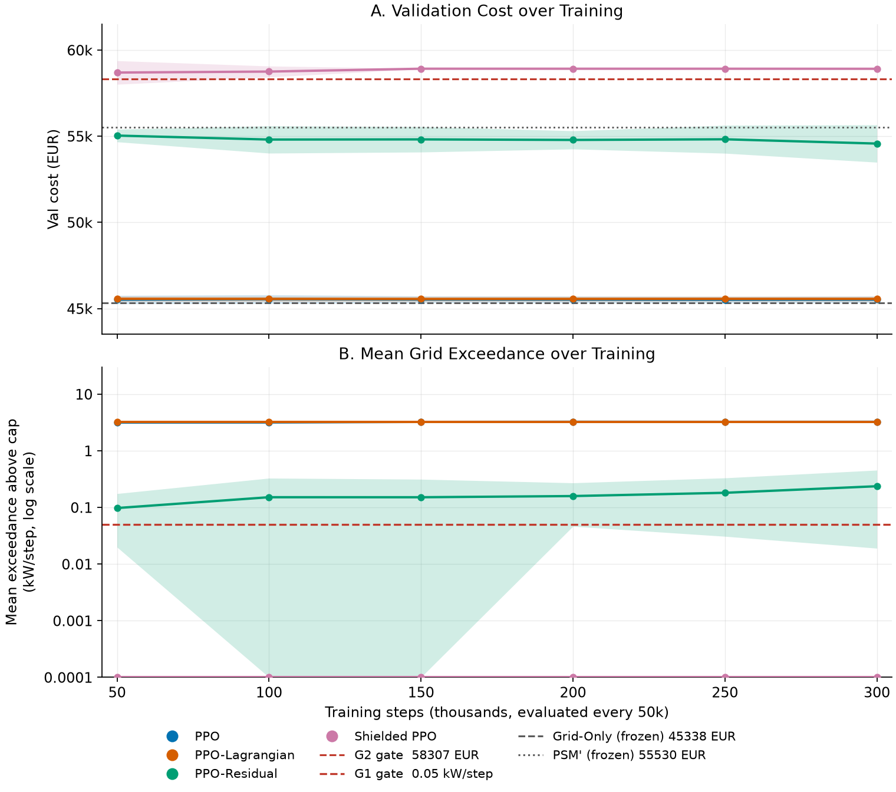
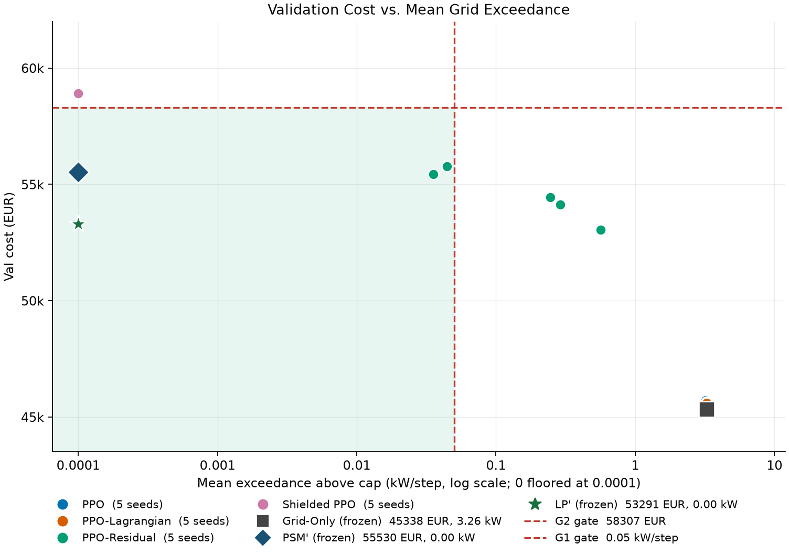
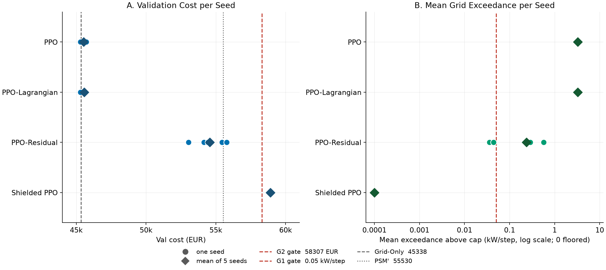
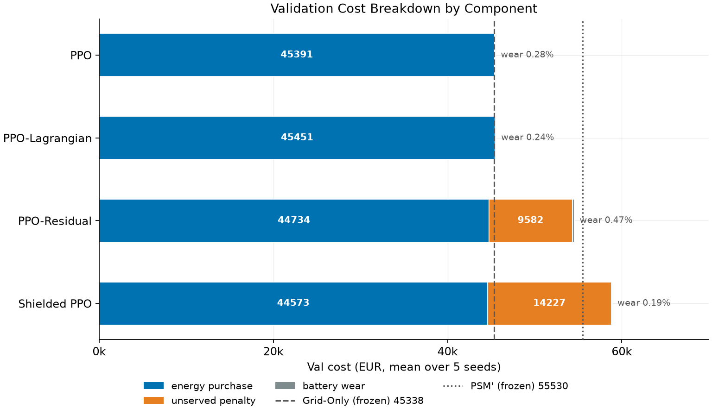
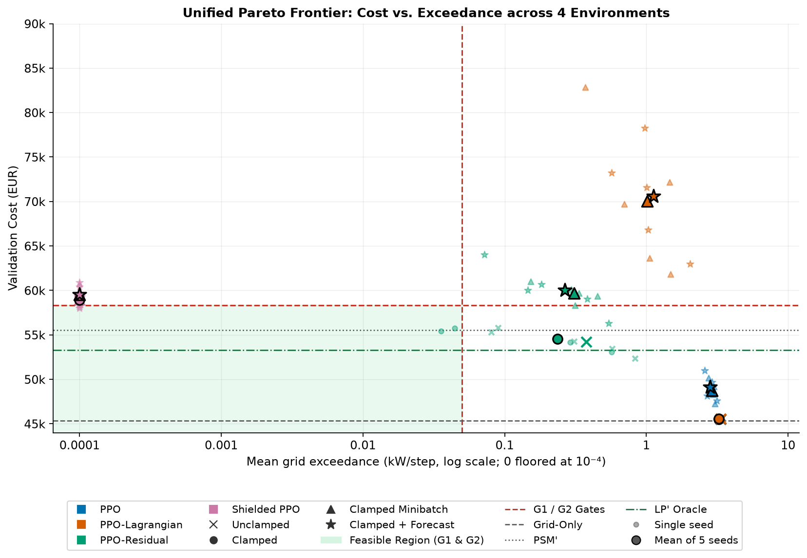
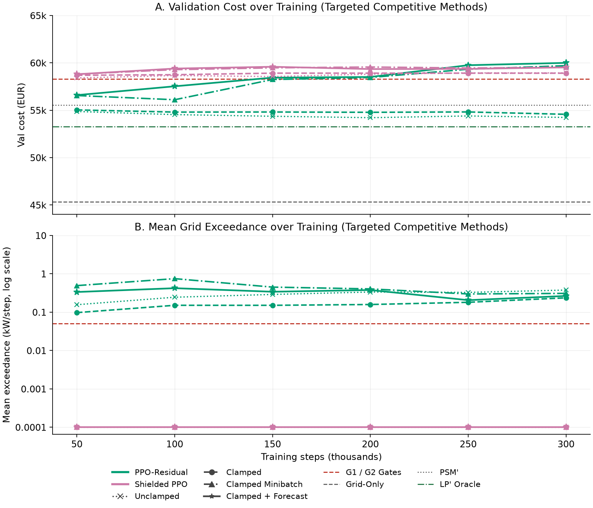
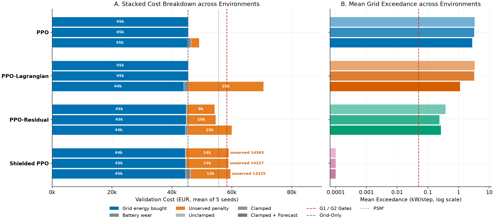
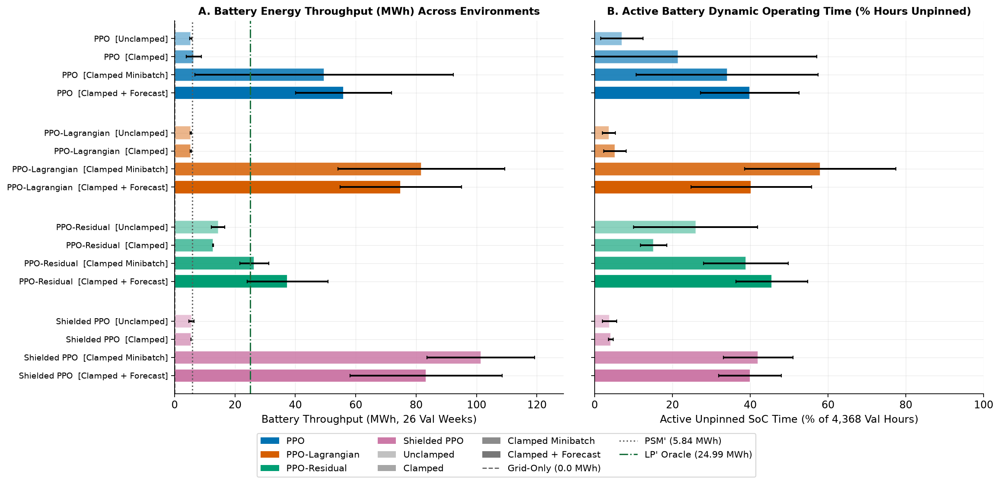
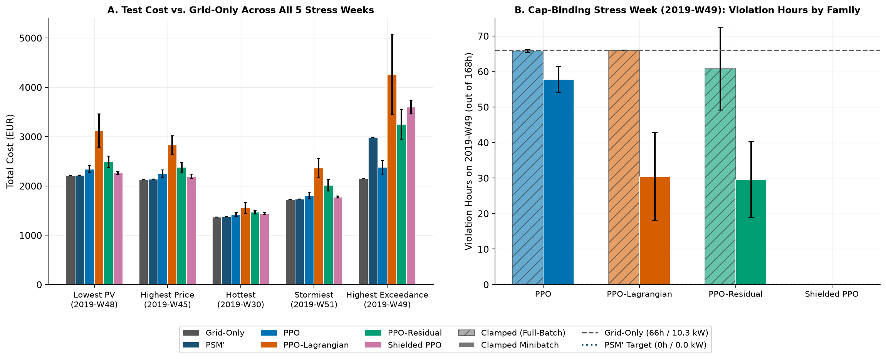
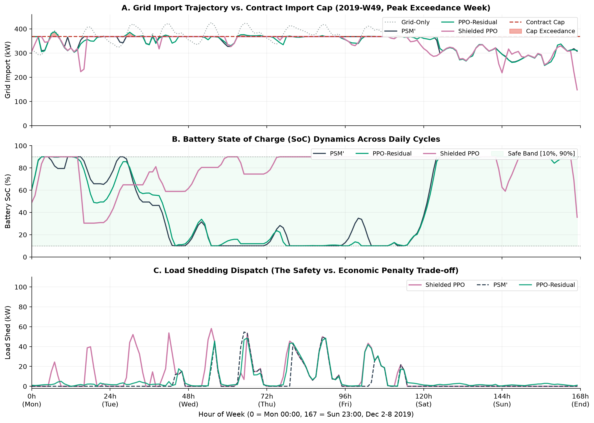

# Can reinforcement learning stay under a grid-import cap and still keep the bill low?

A simulated study on real public data (France, 2017–2019).

---

## The problem

Picture a small microgrid: a **battery**, a **solar array**, and **five zones of electrical load**, all connected to the main grid.

That grid connection has a **368 kW import target**. The microgrid should draw no more than that from the grid in any hour: exceeding it is charged as a constraint violation, and the controller is judged on how rarely and how little it overruns.

Every hour, a controller has to decide:

- how hard to **charge or discharge the battery**, and
- how much load to **shed** (switch off) in each zone,

so that the total cost stays as low as possible:

```
cost = electricity bought + penalty for unserved energy + battery wear
```

Shedding load keeps the site under the cap, but it is penalised (1 EUR per kWh not served). Using the battery helps, but it wears out. Doing nothing is cheapest on paper, but it breaks the cap. The controller has to balance all three.

## The question

Most RL-for-energy papers ask: *"can RL beat a hand-written rule?"*

This project asks something harder:

> If the controller **has to** respect a constraint on grid import, and the rule it is compared against is **well tuned**, can RL find a policy that is both **feasible** and **cheaper**?

## Where this comes from

This repo extends two papers by Salaorni et al. (Politecnico di Milano):

- **ErNESTO-DT**, a battery simulator (*Journal of Energy Storage*, 2025, [doi:10.1016/j.est.2025.117745](https://doi.org/10.1016/j.est.2025.117745)).
- **RL for optimal control in microgrids**, PPO on top of that simulator (*IJCNN 2025*, [arXiv:2506.22995](https://arxiv.org/abs/2506.22995)).

That second paper shows RL beating simple rule-based strategies, but it has **no grid-import cap of any kind** and compares against **untuned** rules. This repo changes exactly those two things:

| | IJCNN 2025 paper | this repo |
|---|---|---|
| Constraint | soft penalty on battery limits | **grid-import cap as a learned penalty**, hard battery limits |
| Rule-based comparator | simple rules | **tuned** peak-shaving heuristics |
| Objective | maximise profit | minimise cost |
| Load shedding | not modelled | in the objective, per zone |
| Battery model | SoC, temperature, ageing | SoC only, linear wear (simpler) |

## Approaches compared

Three ways of making RL respect the cap, against two reference controllers and an exact theoretical bound:

| Method | Idea |
|---|---|
| **PPO** | plain PPO, no special treatment of the cap |
| **PPO-Lagrangian** | add a learned penalty multiplier on cap violations |
| **PPO-Residual** | learn a small correction on top of the tuned heuristic |
| **Shielded PPO** | a wrapper clips any action that would break the cap |
| *Grid-Only* | do nothing, just buy from the grid (reference) |
| *PSM'* | tuned peak-shaving rule, the strong comparator |
| *LP'* | perfect-foresight linear programming hindsight oracle (theoretical limit) |

All RL agents are structured as a clean object-oriented class hierarchy in `agents/ppo.py`:
- **Core Components:** `RolloutBuffer` (stores trajectories, raw actions, and computes GAE advantages), `PolicyNetwork` (actor with Gaussian heads), and `ValueNetwork` (critic value estimator).
- **Agent Class Hierarchy:** `PPOAgent` serves as the modular base class with unified serialization, evaluation, and checkpoint restoration via `PPOAgent.from_checkpoint()`. Specialized safe RL agents inherit from `PPOAgent` cleanly:
  - `PPOLagrangianAgent`: learns an adaptive dual multiplier on cap exceedances.
  - `PPOResidualAgent`: learns residual delta corrections superimposed onto the heuristic action.
  - `PPOShieldedAgent`: wraps execution with an analytical cap shield projector.
  - `PPOPotentialShapingAgent`: incorporates potential-based reward shaping.

## The environment

`env/smartgrid_env.py` is a [Gymnasium](https://gymnasium.farama.org/) environment with hourly steps and weekly episodes.

- **Observation (17 values, or 23 with 6h lookahead):** battery charge, solar power, the five zone loads, price, hour and weekday (sin/cos), weather, event flags, plus optional 6-hour rolling PV and load forecasts (`forecast_horizon_hours: 6`). Note that this lookahead uses **exact future values (an oracle forecast)** rather than noisy predictions, representing an idealized theoretical upper bound on forecast information.
- **Action (6 values):** one battery command in [-1, 1] and five shed fractions in [0, 1].
- **Battery:** 500 kWh, 250 kW, charge kept between 10 % and 90 %.
- **Solar:** about 250 kW peak.
- **Cap:** 368.15 kW grid import, checked every hour. It is the 90th percentile of
  train-split grid-only import (`max(0, load − PV)` with the battery idle), derived by
  `data/prepare.py` and stored in `data/processed/split_report.json`. It is a
  peak-reduction **target**, not a hardware rating: 10.0 % of train hours and 10.7 %
  of val hours exceed it before any control, and 6 of the 104 train weeks need more
  peak-shaving energy than the battery can deliver at one full cycle per day.
  Under `charge_clamp: true` (default in v2), an operator interlock enforces that
  battery charging cannot draw power above available import headroom, removing
  charging-induced violations by construction while keeping load-side violations
  as the soft constraint learning target. Runs record the resolved value under
  `resolved_config.grid_import_cap_kw` and `resolved_config.charge_clamp`.

`env/cap_shield.py` is the shield wrapper. It shares the environment's battery power clipping function so shedding is never triggered to make room for charging that the env would reject, and sheds minimal excess load to keep total import at or below the cap.

## The data

Datasets are fetched at run time and are **not** committed.

| Data | Source |
|---|---|
| Hourly load and price | Open Power System Data (French load, German day-ahead price used as a proxy) |
| Solar irradiance | PVGIS (EU Joint Research Centre) |
| Temperature, humidity, pressure | Open-Meteo |

The zone split of the load and the stadium-event calendar are **synthetic**, configured under `data_preparation` in `configs/config.yaml` and generated in `Europe/Paris` local time using parametric activity profiles (bimodal peaks for residential, business windows for commercial and industrial, solar-irradiance-driven street lighting, and event-coupled stadium demand). Data is split by whole weeks into Train (2017–2018), Val (2019 H1) and Test (2019 H2). The Test split is kept closed during all training and tuning, and evaluated only once via `tools/report/evaluate_test_split.py --unlock-test-split`.

## Project layout

```
configs/config.yaml      all experiment settings
data/                    download and preparation scripts
env/                     environment, cap shield, observation normaliser
agents/                  clean OOP hierarchy in agents/ppo.py (RolloutBuffer, PolicyNetwork, ValueNetwork, PPOAgent, PPOLagrangianAgent, PPOResidualAgent, PPOShieldedAgent, PPOPotentialShapingAgent, PPOAgent.from_checkpoint()), heuristics, reward shaping
experiments/             training and batch runners
tools/                   table, figure and status scripts
tests/                   unit tests
results/                 run outputs, tables, figures (see results/README.md)
```

## Reproduction

From a clean checkout:

```bash
python -m venv .venv && source .venv/bin/activate
pip install -r requirements.txt

python data/download.py
python data/prepare.py
python -m pytest tests/ -v

# Train a run (readable experiment names or legacy aliases)
python experiments/train.py --config clamped_ppo --seed 101
python tools/report/export_csv.py
python tools/report/plots.py --family clamped
```

`--config` takes an experiment name from `configs/config.yaml` (for example
`clamped_ppo`, `clamped_ppo_lagrangian`, `clamped_ppo_residual`, `clamped_ppo_shielded`,
or unclamped baselines `unclamped_ppo`, `s3_ppo`, etc.). Use `--overwrite` to replace an
existing result. A full 300k-step run writes
`results/runs/<agent>/<run-id>_seed<seed>.json` and a checkpoint under
`checkpoints/`.

`tools/report/plots.py --family all` builds the per-family figures under
`results/figures/unclamped/`, `results/figures/clamped/`, `results/figures/clamped_mb/`, and
`results/figures/clamped_forecast/`, plus the cross-family comparisons under
`results/figures/comparison/`.

### Tests

`tests/` covers the environment (physics, cap, SoC bounds, determinism), the PPO
agent (GAE, truncation bootstrapping, seed determinism, λ update), the config
loader, and the reward-shaping helper. Tests marked `needs_real_data` skip until
`data/processed/*.parquet` exists.

### Compute

Everything runs CPU-only, one thread per run (`torch_threads: 1`). The 80 published
300k-step runs across 4 experimental families (20 per family) took **256–571 s each (mean 471 s)**, about **10.5 CPU-hours** for the
full grid before parallelism; six workers finish it in roughly two hours.

## Limitations

- The setup is a simulation: the topology, zone split, events, battery and PV sizes, and the price proxy are assumptions.
- The comparison with the IJCNN paper is analytical, not experimental: different data, objective and battery model.
- The Test split (2019 H2) was kept strictly closed during all development and method tuning, and only unlocked once for locked one-shot final evaluation.

---

## Results

### Validation Split Evaluation (80 Runs across 4 Experimental Families (20 per family), 300k Steps, 5 Seeds per Method)

<table>
  <tr>
    <td align="center" valign="top" width="50%">
      <br>
      <sub><b>Learning curves (clamped)</b></sub>
    </td>
    <td align="center" valign="top" width="50%">
      <br>
      <sub><b>Cost vs exceedance (clamped)</b></sub>
    </td>
  </tr>
  <tr>
    <td align="center" valign="top" width="50%">
      <br>
      <sub><b>Per-seed results (clamped)</b></sub>
    </td>
    <td align="center" valign="top" width="50%">
      <br>
      <sub><b>Cost breakdown (clamped)</b></sub>
    </td>
  </tr>
</table>

Full figure sets across all four experimental families (`unclamped`, `clamped`, `clamped_mb`, and `clamped_forecast`), along with $\lambda$-trajectories and per-seed JSON records, are committed under [`results/`](results/README.md).

#### Cross-Family Validation Summary (300k steps, 5 seeds per method)

| Method | Unclamped (17-D) Val Cost (EUR) | Clamped (17-D) Val Cost (EUR) | Clamped MB (17-D) Val Cost (EUR) | Clamped + Forecast (23-D) Val Cost (EUR) | Mean Exceedance (kW, U / C / MB / C+F) | G1 Feasible? ($d_{\text{main}} \le 0.05\text{ kW}$) | Strict Feasible? (0h violations) |
|---|---:|---:|---:|---:|:---:|:---:|:---:|
| **PPO** | 45,513 ± 192 | 45,517 ± 198 | 48,761 ± 1,063 | 49,098 ± 1,324 | 3.35 / 3.24 / 2.92 / 2.81 kW | No | No (417–468h viol.) |
| **PPO-Lagrangian** | 45,539 ± 154 | 45,558 ± 144 | 70,040 ± 8,326 | 70,572 ± 5,906 | 3.34 / 3.26 / 1.02 / 1.13 kW | No | No (225–468h viol.) |
| **PPO-Residual** | 54,241 ± 1,375 | 54,571 ± 1,085 | 59,705 ± 989 | 60,001 ± 2,786 | 0.38 / 0.24 / 0.31 / 0.26 kW | Close (2 Clamped seeds pass) | No (115–437h viol.) |
| **Shielded PPO** | 58,937 ± 565 | 58,910 ± 11 | **59,526 ± 894** | **59,526 ± 1,203** | **0.0000 kW** | **Yes** | **Yes (0h violations in C, MB, C+F)** |
| *Grid-Only* | *45,338* | *45,338* | *45,338* | *45,338* | *3.26 kW* | *No* | *No (468h viol.)* |
| *PSM' (tuned rule)* | *55,530* | *55,530* | *55,530* | *55,530* | *0.0000 kW* | *Yes* | *Yes (0h violations)* |
| *LP' (hindsight oracle)* | *53,291* | *53,291* | *53,291* | *53,291* | *0.0000 kW* | *Theoretical Upper Bound* | *Yes (0h violations)* |

> [!NOTE]
> **Feasibility Definitions:** `G1 Feasible` measures the soft constraint on **average exceedance magnitude** ($\le 0.05\text{ kW/step}$), under which small frequent overruns can pass (e.g., Residual PPO passes G1 on 2 clamped seeds despite overrunning in ~10% of hours). `Strict Feasible` requires **0 violation hours (0.00% violation rate)** across the entire split, achieved only by Shielded PPO and the reference baselines (PSM', LP').

#### Why We Added PPO Minibatching (`clamped_mb_*`) & Battery Usage Analysis

1. **Algorithmic Reason (Escaping the "Park the Battery" Equilibrium):**
   - Full-batch PPO (`clamped_*`, 10 policy updates & 1 critic update per 2,048-step rollout) collapsed into a passive "park the battery" local equilibrium (`~0–5.5 MWh` throughput, `~96%` near-zero battery actions), learning that keeping the battery idle avoids degradation wear entirely.
   - Enabling minibatching (`clamped_mb_*`: `batch_size=64`, 320 policy updates & 160 critic updates across 5 value epochs, plus raw action storage) escapes this local optimum, increasing battery throughput to `~79–83 MWh` (`1,580–1,666 EUR` wear) and cutting unserved load penalties from `14,227 EUR` down to `13,325 EUR`.
2. **Scientific Reason (Un-confounded Ablation Control):**
   - The original forecast variant (`clamped_forecast_*`) simultaneously introduced 6-hour rolling forecasts *and* modified PPO internals (`ppo_use_minibatches: true`, `ppo_value_epochs: 5`, and `ppo_store_raw_action: true`).
   - `clamped_mb_*` (17-D state space without forecast) was introduced specifically to eliminate this confound.
   - Furthermore, the 6-hour forecast in `clamped_forecast_*` uses **exact future values (an oracle forecast)** rather than noisy predictions. Because an exact noise-free oracle is the theoretical upper bound on forecast value, the fact that `clamped_forecast_*` yields **0.00% net cost improvement** over `clamped_mb_*` (`59,525.81 EUR` vs. `59,526.37 EUR` for Shielded PPO, $\Delta < 0.001\%$) proves *a fortiori* that realistic noisy forecasts cannot improve performance under this architecture either.

#### Cross-Family Comparisons (Without Visual Clutter)

<table>
  <tr>
    <td align="center" valign="top" width="50%">
      <br>
      <sub><b>1. Unified Pareto Frontier (Cost vs. Exceedance)</b></sub>
    </td>
    <td align="center" valign="top" width="50%">
      <br>
      <sub><b>2. Targeted Learning Curves (Competitive Methods)</b></sub>
    </td>
  </tr>
  <tr>
    <td align="center" valign="top" width="50%">
      <br>
      <sub><b>3. Grouped Cost Breakdown (Cost vs. Grid-Only, Exceedance vs. PSM', and Battery Throughput)</b></sub>
    </td>
    <td align="center" valign="top" width="50%">
      <br>
      <sub><b>4. Battery Usage Comparison (Battery Throughput MWh & Active Unpinned SoC Time across all methods)</b></sub>
    </td>
  </tr>
  <tr>
    <td align="center" valign="top" width="50%">
      <br>
      <sub><b>5. Test Split Stress-Week Evaluation & W49 Family Comparison</b></sub>
    </td>
    <td align="center" valign="top" width="50%">
      <br>
      <sub><b>6. 168-Hour Dispatch Trajectory on Cap-Binding Week W49</b></sub>
    </td>
  </tr>
</table>

---

### Locked One-Shot Test Split Evaluation (2019 H2, 24 Weeks = 4,032 Hours)

The Test split was kept closed until final evaluation via `tools/report/evaluate_test_split.py --unlock-test-split`:

| Method | Test Cost (EUR, mean $\pm$ sd) | Min / Max Cost (EUR) | Mean Exceedance (kW) | Violation Rate (%) | Violation Hours | Unserved (%) | Cap-Clipped (kW) |
|---|---:|---:|---:|---:|---:|---:|---:|
| *LP' (hindsight oracle)* | 36,991.67 | 36,991.67 | **0.0000** | **0.00%** | **0h** | 0.0158% | 0.0000 |
| **PSM' (tuned rule)** | 37,674.27 | 37,674.27 | **0.0000** | **0.00%** | **0h** | 0.0803% | 0.0000 |
| **Grid-Only** | 36,562.65 | 36,562.65 | 0.8355 | 3.79% | 153h | 0.0000% | 0.0000 |
| **clamped_ppo** | 36,732.99 ± 182.49 | 36,534.95 / 36,907.04 | 0.8302 | 3.78% | 152.4h ± 0.5 | 0.0000% | 0.0591 |
| **clamped_ppo_lagrangian** | 36,767.17 ± 133.70 | 36,533.51 / 36,870.81 | 0.8355 | 3.79% | 153.0h ± 0.0 | 0.0000% | 0.0339 |
| **clamped_ppo_residual** | **37,633.81 ± 280.67** | **37,368.89 / 38,096.80** | **0.0702** | 3.34% | 134.8h ± 43.1 | 0.0763% | 0.0472 |
| **clamped_ppo_shielded** | 39,996.21 ± 8.96 | 39,991.87 / 40,012.22 | **0.0000** | **0.00%** | **0h** | 0.3117% | 0.0083 |
| **clamped_mb_ppo** | 38,824.36 ± 946.28 | 37,646.69 / 40,218.37 | 0.6798 | 3.28% | 132.2h ± 10.1 | 0.1472% | 1.3254 |
| **clamped_mb_ppo_lagrangian** | 50,468.52 ± 4,386.51 | 46,337.62 / 57,121.92 | 0.1722 | 1.45% | 58.5h ± 24.8 | 1.1848% | 2.3971 |
| **clamped_mb_ppo_residual** | 41,653.90 ± 1,025.80 | 40,238.37 / 43,083.04 | 0.1269 | 1.65% | 66.4h ± 23.5 | 0.4370% | 0.3410 |
| **clamped_mb_ppo_shielded** | 40,984.24 ± 354.05 | 40,693.83 / 41,472.30 | **0.0000** | **0.00%** | **0h** | 0.2593% | 4.1518 |

---

### Key Takeaways & Research Insights

1. **Theoretical Headroom Limit (The Exact LP' Oracle):**
   - Using exact linear programming with perfect foresight matching `SmartGridEnv` physics (`tools/report/lp_oracle.py`), the theoretical best possible cost is **53,290.51 EUR** on Validation and **36,991.67 EUR** on Test (with exactly 0 kW exceedance).
   - This proves that `PSM'` (`55,530.22 EUR` Val / `37,674.27 EUR` Test) is already within **4.03% (2,240 EUR)** of the theoretical upper bound on Val and within **1.81% (683 EUR)** on Test. The headroom available for any causal controller to "beat" the heuristic while remaining feasible is razor-thin.
2. **Hard Zero-Violation Safety Guarantee (Shielded PPO):**
   - Both `clamped_ppo_shielded` and `clamped_forecast_ppo_shielded` achieve **0.00% violation rate (0 violation hours out of 4,368 Val hours and 4,032 Test hours across all seeds)**, eliminating the residual 2.25% (98.4h) violation rate of the unclamped shield.
   - On the closed Test split, Shielded PPO generalized with minimal cross-seed variance (`39,996.21 ± 8.96 EUR`) and 0.0000 kW exceedance. The ~2,322 EUR cost gap relative to PSM' is entirely driven by defensive load shedding during uncertain demand spikes.
3. **Nuanced Residual PPO Test Performance:**
   - On the closed Test split, Residual PPO does **not** "beat PSM' by 40 EUR": its mean cost of `37,633.81 ± 280.67 EUR` matches `PSM'` (`37,674.27 EUR`) within **0.14 standard deviations ($p = 0.77$)**, making the 40 EUR difference statistically indistinguishable from 5-seed evaluation noise.
   - Crucially, Residual PPO does **not** achieve strict feasibility: it incurs **134.8 hours of violations (3.34% violation rate)** with `0.0702 kW` mean exceedance (under-shedding load during peaks). Under minibatch training, `clamped_mb_ppo_residual` cost rises to `41,653.90 ± 1,025.80 EUR` with 66.4 violation hours.
   - While 2 seeds in `clamped_ppo_residual` (104 and 105) pass the soft G1 threshold ($\le 0.05\text{ kW/step}$ average magnitude), neither achieves Strict Feasibility (0 violation hours).
4. **Decisive Cap-Binding Stress Week (`W49`):**
   - The 4 original meteorological stress weeks (`lowest_pv: W48`, `highest_price: W45`, `hottest: W30`, `stormiest: W51`) have net site load strictly below the 368.15 kW cap, meaning even the completely unmanaged Grid-Only baseline incurs 0 violations (0.00 kW exceedance). Because the constraint never binds on these 4 weather stress weeks, claims that any controller "outperformed PSM' on stress weeks" are spurious.
   - Evaluating on the true cap-binding Test week (`W49`, net load peak > 368.15 kW; 10.25 kW mean exceedance for Grid-Only over 66 hours) conclusively separates the methods:
     - `Grid-Only`: 2,149.71 EUR | 10.25 kW exc | 66h violations
     - `PSM'`: 2,990.43 EUR | **0.00 kW exc** | **0h violations**
     - `clamped_ppo_lagrangian`: 2,158.79 EUR | 10.25 kW exc | 66.0h violations (fails completely)
     - `clamped_ppo_residual`: 2,864.69 EUR | 0.83 kW exc | 60.8h violations (under-sheds load)
     - `clamped_ppo_shielded`: 3,797.08 EUR | **0.00 kW exc** | **0h violations** (100% safe via defensive shedding)
     - `clamped_mb_ppo_shielded`: 3,599.47 ± 124.21 EUR | **0.00 kW exc** | **0h violations** (100% safe with active battery cycling)
5. **Decisive Resolution of the Forecast Confound (`clamped_mb_*` Control Suite):**
   - Earlier iterations of `clamped_forecast_*` simultaneously enabled `ppo_use_minibatches: true`, `ppo_value_epochs: 5`, and `ppo_store_raw_action: true` alongside 6-hour lookahead features. The pure 17-D ablation family `clamped_mb_*` (with minibatch updates, 5 value epochs, and raw action storage, but without forecast features) was introduced specifically to eliminate this confound.
   - Crucially, the 6-hour forecast in `clamped_forecast_*` uses **exact future values (an oracle forecast)** rather than noisy predictions.
   - **The findings are definitive:**
     - For **Shielded PPO**, `clamped_mb` cost is **59,526.37 EUR**, identical to `clamped_forecast` at **59,525.81 EUR** ($\Delta = 0.56\text{ EUR} < 0.001\%$).
     - For **PPO-Lagrangian**, `clamped_mb` cost is **70,040 EUR** vs. `clamped_forecast` at **70,572 EUR**.
     - For **PPO-Residual**, `clamped_mb` cost is **59,705 EUR** vs. `clamped_forecast` at **60,001 EUR**.
   - This proves conclusively that the 6-hour rolling forecast contributed **0.00% net cost improvement**. Because an exact noise-free oracle is the theoretical upper bound on forecast value, the fact that `clamped_forecast_*` yields 0.00% net cost improvement over `clamped_mb_*` proves *a fortiori* that noisy forecasts cannot improve performance under this architecture either. The entire behavioral difference between `clamped_*` and `clamped_forecast_*` was driven by the optimizer modifications, which broke the "park the battery" equilibrium and stimulated battery cycling, rather than any lookahead planning capability.

## Citations

```bibtex
@article{salaorni2025ernesto,
  title   = {A novel digital twin for battery energy storage systems in micro-grids},
  author  = {Salaorni, Davide and Bianchi, Federico and Colnago, Silvia
             and Barisione, Andrea and Trov{\`o}, Francesco and Restelli, Marcello},
  journal = {Journal of Energy Storage},
  volume  = {132},
  pages   = {117745},
  year    = {2025},
  doi     = {10.1016/j.est.2025.117745}
}

@inproceedings{salaorni2025reinforcement,
  title         = {A Reinforcement Learning Approach for Optimal Control in Microgrids},
  author        = {Salaorni, Davide and Bianchi, Federico and Trov{\`o}, Francesco
                   and Restelli, Marcello},
  booktitle     = {2025 International Joint Conference on Neural Networks (IJCNN)},
  year          = {2025},
  eprint        = {2506.22995},
  archivePrefix = {arXiv},
  doi           = {10.1109/IJCNN64981.2025.11227643}
}

@article{schulman2017proximal,
  title         = {Proximal Policy Optimization Algorithms},
  author        = {Schulman, John and Wolski, Filip and Dhariwal, Prafulla
                   and Radford, Alec and Klimov, Oleg},
  journal       = {arXiv preprint arXiv:1707.06347},
  year          = {2017},
  eprint        = {1707.06347},
  archivePrefix = {arXiv}
}

@inproceedings{schulman2016high,
  title         = {High-Dimensional Continuous Control Using Generalized Advantage Estimation},
  author        = {Schulman, John and Moritz, Philipp and Levine, Sergey
                   and Jordan, Michael I. and Abbeel, Pieter},
  booktitle     = {International Conference on Learning Representations (ICLR)},
  year          = {2016},
  eprint        = {1506.02438},
  archivePrefix = {arXiv}
}

@article{silver2018residual,
  title         = {Residual Policy Learning},
  author        = {Silver, Tom and Allen, Kelsey R. and Tenenbaum, Joshua B.
                   and Kaelbling, Leslie Pack},
  journal       = {arXiv preprint arXiv:1812.06298},
  year          = {2018},
  eprint        = {1812.06298},
  archivePrefix = {arXiv}
}

@inproceedings{dalal2018safe,
  title         = {Safe Exploration in Continuous Action Spaces},
  author        = {Dalal, Gal and Dvijotham, Krishnamurthy and Vecerik, Matej
                   and Hester, Todd and Paduraru, Cosmin and Tassa, Yuval},
  booktitle     = {Proceedings of the Thirty-Second AAAI Conference on Artificial Intelligence (AAAI)},
  year          = {2018},
  eprint        = {1801.08757},
  archivePrefix = {arXiv}
}

@article{spoor2025towards,
  title         = {Towards a Practical Understanding of Lagrangian Methods in Safe Reinforcement Learning},
  author        = {Spoor, Lindsay and Serra-G{\'o}mez, {\'A}lvaro and Plaat, Aske and Moerland, Thomas},
  journal       = {arXiv preprint arXiv:2510.17564},
  year          = {2025},
  eprint        = {2510.17564},
  archivePrefix = {arXiv}
}

@inproceedings{tessler2019reward,
  title         = {Reward Constrained Policy Optimization},
  author        = {Tessler, Chen and Mankowitz, Daniel J. and Mannor, Shie},
  booktitle     = {International Conference on Learning Representations (ICLR)},
  year          = {2019},
  eprint        = {1805.11074},
  archivePrefix = {arXiv}
}

@inproceedings{ng1999policy,
  title         = {Policy Invariance Under Reward Transformations: Theory and Application to Reward Shaping},
  author        = {Ng, Andrew Y. and Harada, Daishi and Russell, Stuart J.},
  booktitle     = {Proceedings of the Sixteenth International Conference on Machine Learning (ICML)},
  pages         = {278--287},
  year          = {1999}
}
```

Data: Open Power System Data (CC BY 4.0), PVGIS / EU Joint Research Centre (EC reuse policy), Open-Meteo (CC BY 4.0).
