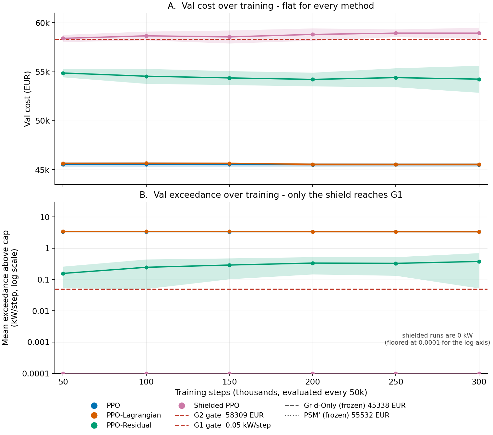
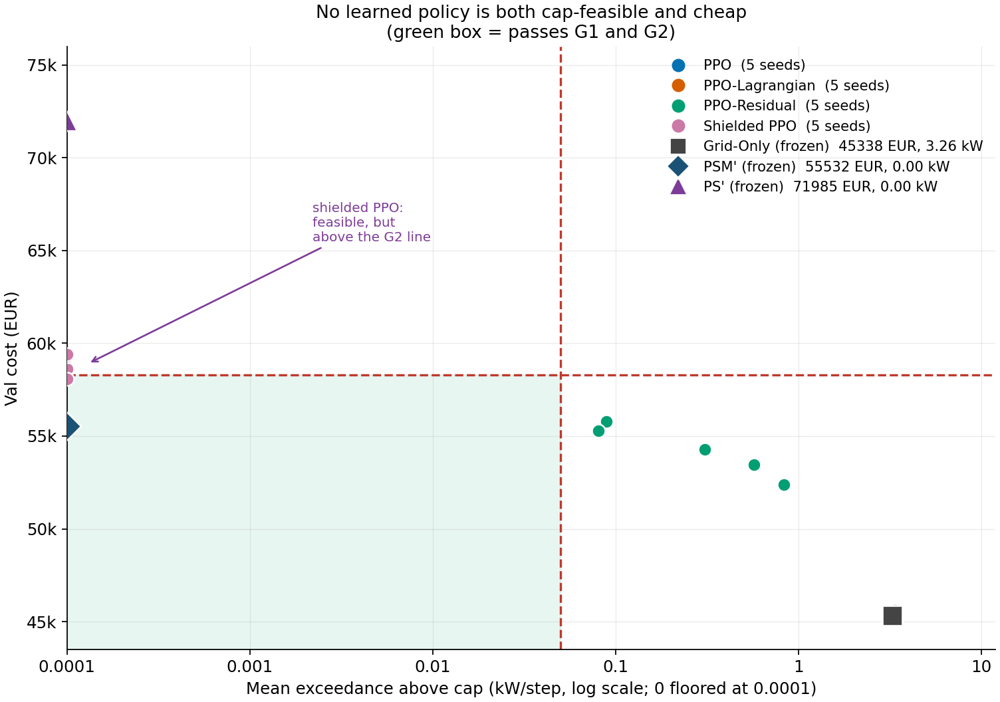
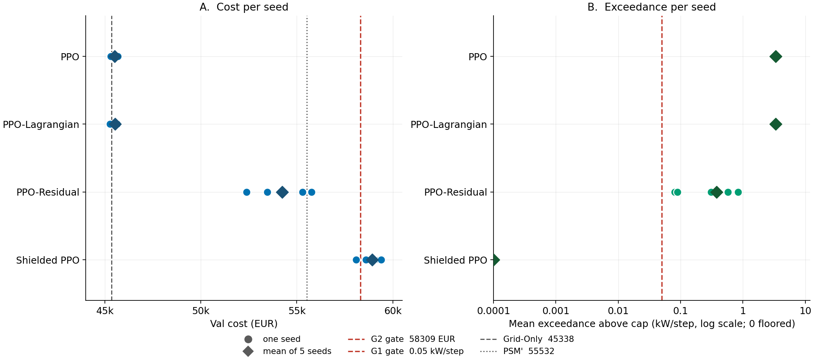
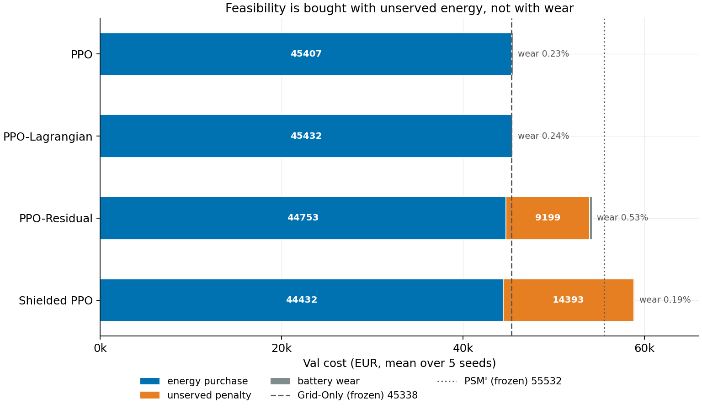

**Can reinforcement learning respect a hard limit on grid import, and still keep the bill low?**

A simulated study on real public data (France, 2017-2019).

> **Status: prototype snapshot** (`git tag v0-prototype`). The negative result is the
> point of the study; the code is research-grade, not a maintained library. Decisions,
> verification scope and known gaps are in **[NOTES.md](NOTES.md)**. The committed
> results and how to rebuild them are described in **[results/README.md](results/README.md)**.

---

## The problem:
Picture a small microgrid: a **battery**, a **solar array**, and **five zones of electrical load**, all connected to the main grid.

That grid connection has a hard limit. Whatever happens, the microgrid must **never draw more than 368 kW** from the grid in any hour.

Every hour, a controller has to decide:

- how hard to **charge or discharge the battery**, and
- how much load to **shed** (switch off) in each zone,

so that the total cost stays as low as possible:

```
cost = electricity bought + penalty for unserved energy + battery wear
```

Shedding load keeps you under the cap, but it is penalised (1 EUR per kWh not served). Using the battery helps, but it wears out. Doing nothing is cheapest on paper, but it breaks the cap. The controller has to balance all three.

## The question

Most RL-for-energy papers ask: *"can RL beat a hand-written rule?"*

This project asks something harder:

> If the controller **must** respect a hard constraint, and the rule it is compared against is **well tuned**, can RL find a policy that is both **feasible** and **cheaper**?

## Where this comes from

This repo extends two papers by Salaorni et al. (Politecnico di Milano):

- **ErNESTO-DT**, a battery simulator (*Journal of Energy Storage*, 2025, [doi:10.1016/j.est.2025.117745](https://doi.org/10.1016/j.est.2025.117745)).
- **RL for optimal control in microgrids**, PPO on top of that simulator (*IJCNN 2025*, [arXiv:2506.22995](https://arxiv.org/abs/2506.22995)).

That second paper shows RL beating simple rule-based strategies, but it has **no hard grid-import cap** and compares against **untuned** rules. This repo changes exactly those two things:

| | IJCNN 2025 paper | this repo |
|---|---|---|
| Constraint | soft penalty on battery limits | **hard cap on grid import** |
| Rule-based comparator | simple rules | **tuned** peak-shaving heuristics |
| Objective | maximise profit | minimise cost |
| Load shedding | not modelled | in the objective, per zone |
| Battery model | SoC, temperature, ageing | SoC only, linear wear (simpler) |

## Approaches compared

Three ways of making RL respect the cap, against two reference controllers:

| Method | Idea |
|---|---|
| **PPO** | plain PPO, no special treatment of the cap |
| **PPO-Lagrangian** | add a learned penalty multiplier on cap violations |
| **PPO-Residual** | learn a small correction on top of the tuned heuristic |
| **Shielded PPO** | a wrapper clips any action that would break the cap |
| *Grid-Only* | do nothing, just buy from the grid (reference) |
| *PSM'* | tuned peak-shaving rule, the strong comparator |

## The environment

`env/smartgrid_env.py` is a [Gymnasium](https://gymnasium.farama.org/) environment with hourly steps and weekly episodes.

- **Observation (17 values):** battery charge, solar power, the five zone loads, price, hour and weekday (sin/cos), weather, and event flags.
- **Action (6 values):** one battery command in [-1, 1] and five shed fractions in [0, 1].
- **Battery:** 500 kWh, 250 kW, charge kept between 10 % and 90 %.
- **Solar:** about 250 kW peak.
- **Cap:** 368.15 kW grid import, checked every hour.

`env/cap_shield.py` is the shield wrapper. It clips the battery command so the cap can't be exceeded and turns any remaining violation into shed load.

## The data

Datasets are fetched at run time and are **not** committed:

```bash
python data/download.py     # ~130 MB into data/raw/
python data/prepare.py      # builds data/processed/*.parquet
```

SHA-256 checksums for the three expected raw files live in `data/checksums.json`;
`download.py` verifies them automatically.

| Data | Source |
|---|---|
| Hourly load and price | Open Power System Data (French load, German day-ahead price used as a proxy) |
| Solar irradiance | PVGIS (EU Joint Research Centre) |
| Temperature, humidity, pressure | Open-Meteo |

The zone split of the load and the stadium-event calendar are **synthetic**. Data is split by whole weeks into Train (2017-2018), Val (2019 H1) and Test (2019 H2). The Test split is kept closed and is not used by any code here.

## Project layout

```
configs/config.yaml      all experiment settings
data/                    download and preparation scripts
env/                     environment, cap shield, observation normaliser
agents/                  PPO, heuristics, networks, reward shaping
experiments/             training and batch runners
tools/                   table, figure and status scripts
tests/                   unit tests
results/                 run outputs, tables, figures (see results/README.md)
NOTES.md                 decision log, verification scope, known gaps
```

## Reproduction

The short version, from a clean checkout:

```bash
python -m venv .venv && source .venv/bin/activate
pip install -r requirements.txt

python data/download.py          # ~130 MB, checksum-verified
python data/prepare.py           # builds data/processed/*.parquet
python -m pytest tests/ -v       # unit suite

python experiments/train.py --config s3_ppo --seed 101
python tools/report/export_csv.py
python tools/report/plots.py
```

`--config` takes an experiment name from `configs/config.yaml` (for example
`s3_ppo`, `s3_ppo_lag`, `s3_ppo_res`, `s3_sh_ppo`). Use `--overwrite` to replace an
existing result. A full 300k-step run writes
`results/runs/<agent>/<run-id>_seed<seed>.json` and a checkpoint under
`checkpoints/`.

### Test status

`tests/` covers the environment (physics, cap, SoC bounds, determinism), the PPO
agent (GAE, truncation bootstrapping, seed determinism, λ update), the config
loader, and the reward-shaping helper. Some tests are marked `needs_real_data`
and skip until `data/processed/*.parquet` exists.

In the fresh-venv verification for this snapshot, the **full suite passed 30/30**
with the real dataset present and the CPU-only `torch==2.14.1+cpu` build (187 MB,
no NVIDIA runtime). A short `bench10k` PPO run also completed end to end. The
published 300k-step results were not re-run. See [NOTES.md](NOTES.md) (D1) for
the exact scope.

### Hardware and compute

Everything is CPU-only and single-threaded per run (`torch_threads: 1`). The 20
published 300k-step runs recorded **256–571 s each (mean 471 s)** in their result
JSONs — about **2.6 CPU-hours** for the full grid before parallelism. The batch
runner uses one process per run, so 6 workers finish the grid in roughly half an
hour. No GPU is required.

## Limitations

- The setup is a simulation: the topology, zone split, events, battery and PV sizes, and the price proxy are assumptions.
- The comparison with the IJCNN paper is analytical, not experimental: different data, objective and battery model.
- The reported table is Val only. The Test split (2019 H2) is closed and was not evaluated.

---

## Results 

Evaluated on the Val split, 300k training steps, 5 seeds per method.

<table> <tr> <td align="center" valign="top" width="50%"> <br> <sub><b>Learning curves</b></sub> </td> <td align="center" valign="top" width="50%"> <br> <sub><b>Cost vs exceedance</b></sub> </td> </tr> <tr> <td align="center" valign="top" width="50%"> <br> <sub><b>Per-seed results</b></sub> </td> <td align="center" valign="top" width="50%"> <br> <sub><b>Cost breakdown</b></sub> </td> </tr> </table>

All four figures and the per-seed JSONs behind them are committed under
[`results/`](results/README.md). That folder also carries a λ-trajectory
diagnostic (`lambda_trajectory.png`) regenerated from the same runs.


| Method | Val cost (EUR) | Respects the cap? |
|---|---:|:---:|
| PPO | 45,513 | no |
| PPO-Lagrangian | 45,539 | no |
| PPO-Residual | 54,241 | no (close) |
| Shielded PPO | 58,937 | **yes** |
| *Grid-Only* | *45,338* | *no* |
| *PSM' (tuned rule)* | *55,532* | *yes* |


**Takeaways**

- **No learned policy beats the tuned rule while respecting the cap.** The cheap ones (PPO, PPO-Lagrangian) are cheap because they ignore the cap and behave like Grid-Only.
- **The residual comes closest** (about 2 % cheaper than PSM'), but it still breaks the cap slightly on every seed.
- **The shield is the only method that is always feasible, but it works by construction**: it clips the actions, so the policy is effectively removed from the loop. Passing a feasibility test that way says nothing about learning.

So the gap to the original paper comes mostly from the **strength of the comparator** and the **presence of a hard constraint**, not from RL being unable to learn.

## Citations

```bibtex
@article{salaorni2025ernesto,
  title   = {A novel digital twin for battery energy storage systems in micro-grids},
  author  = {Salaorni, Davide and Bianchi, Federico and Colnago, Silvia
             and Barisione, Andrea and Trov{\`o}, Francesco and Restelli, Marcello},
  journal = {Journal of Energy Storage},
  volume  = {132},
  pages   = {117745},
  year    = {2025},
  doi     = {10.1016/j.est.2025.117745}
}

@inproceedings{salaorni2025reinforcement,
  title     = {A Reinforcement Learning Approach for Optimal Control in Microgrids},
  author    = {Salaorni, Davide and Bianchi, Federico and Trov{\`o}, Francesco
               and Restelli, Marcello},
  booktitle = {2025 International Joint Conference on Neural Networks (IJCNN)},
  year      = {2025},
  eprint    = {2506.22995},
  archivePrefix = {arXiv},
  doi       = {10.1109/IJCNN64981.2025.11227643}
}
```

Data: Open Power System Data (CC BY 4.0), PVGIS / EU Joint Research Centre (EC reuse policy), Open-Meteo (CC BY 4.0).
