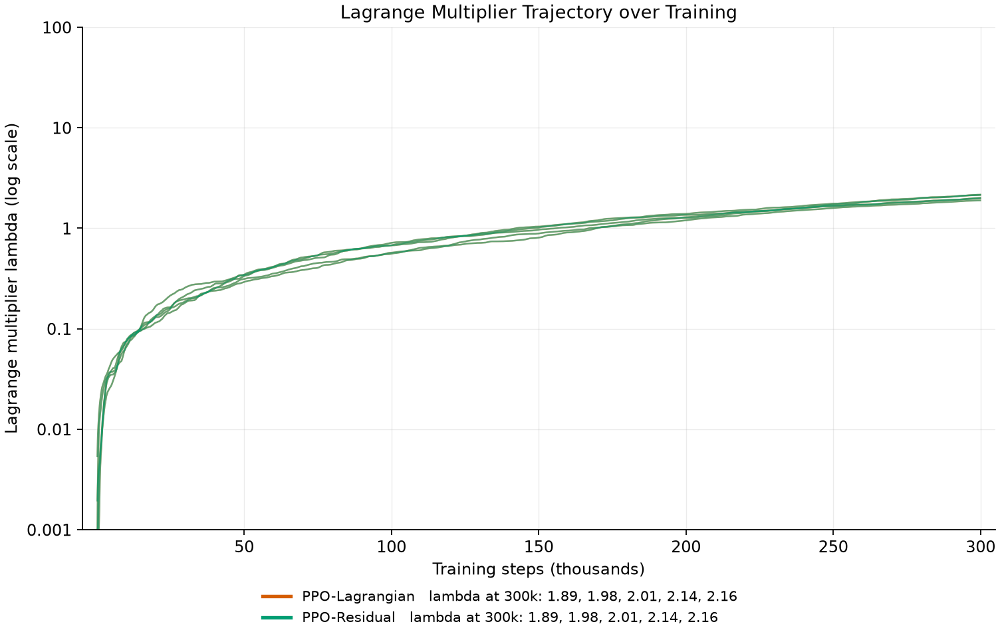

# smartgrid-rl

**Can reinforcement learning respect a hard cap on grid import, and still be cheap?**

A **simulated study on real public data**. It is not a digital twin, not a deployment, not
hardware-in-the-loop, and not a real-world testbed: every number below is produced by a
simulator running on measured public time series.

**Position:** a research extension of two published papers — the *ErNESTO* battery digital
twin and the PPO-for-microgrid-control study built on top of it (Section 2).

**Headline:** on this protocol, **no learned policy is simultaneously cap-feasible and
cheaper than the tuned rule-based controller PSM′**. The only learned method that satisfies
the feasibility gate is the one where the learning is bypassed — the cap shield — and it
costs **+6.1 %** over PSM′ `[verified: results/tables/s2_per_seed.csv]`.

---

## 1. The problem

A microgrid with a battery, a PV array and five load zones is fed from the grid. The
connection has a **hard import cap**: at no hour may grid import exceed
**368.15 kW** — the fixed P90 of the grid-only dispatch on the Train split
`[verified: env/smartgrid_env.py, results/tables/project_constants.csv]`. The controller
must decide, every hour, how hard to charge or discharge the battery and how much load to
shed in each zone, while minimising

```
cost = energy purchase + unserved energy × 1.00 EUR/kWh + battery wear × 0.02 EUR/kWh
```

and while **never** exceeding the cap. The question is not "can RL beat a hand-written
rule?" — the rule can be tuned against the same data. The question is:

> Given a *hard* feasibility constraint and a *strong* rule-based comparator, does
> reinforcement learning find a policy that is both feasible and cheaper?

The honest answer this repo documents is **no**, and the negative result is the point.

---

## 2. Where this sits in the literature

This project is deliberately positioned as an **extension of two specific papers**, and the
contribution is the *combination*, not either paper alone.

### (A) The plant model — ErNESTO-DT

> D. Salaorni, F. Bianchi, S. Colnago, A. Barisione, F. Trovò, M. Restelli,
> *"A novel digital twin for battery energy storage systems in micro-grids"*,
> **Journal of Energy Storage** 132:117745 (2025), doi:[10.1016/j.est.2025.117745](https://doi.org/10.1016/j.est.2025.117745).
> Code: <https://github.com/Daveonwave/ErNESTO-DT>

This paper introduces the battery simulator that the RL paper runs on: a coupled model of
**state of charge, temperature and state of health** for a lithium-ion NMC pack, used to
emulate ageing over a scheduled experiment. It is the reference point for *what a credible
battery model in an energy-storage study looks like*. ("Digital twin" is that paper's own
term for its simulator; this repository is a different, simpler model and is not one.)

### (B) The control method — PPO for optimal microgrid control

> D. Salaorni, F. Bianchi, F. Trovò, M. Restelli,
> *"A Reinforcement Learning Approach for Optimal Control in Microgrids"*,
> **IJCNN 2025**, arXiv:[2506.22995](https://arxiv.org/abs/2506.22995),
> doi:[10.1109/IJCNN64981.2025.11227643](https://doi.org/10.1109/IJCNN64981.2025.11227643).
> Code: <https://github.com/Daveonwave/ErNESTO-gym>

This paper puts PPO with continuous actions on top of (A), adds a battery-degradation term
to the reward, and reports that the learned policy **outperforms rule-based strategies by
6.7 %** against an *OnlyGrid* baseline, on real grid data from the Italian territory.

### What this repo inherits, changes and adds

| Dimension | (A) ErNESTO-DT | (B) IJCNN 2025 | **this repo** |
|---|---|---|---|
| Battery model | SoC + temperature + **SoH** (ageing) | SoC + temperature + SoH via (A) | **SoC only**, throughput-linear wear (0.02 EUR/kWh) `[verified: env/smartgrid_env.py]` |
| Objective | — | maximise **profit** (energy sold at `p^sell`) | minimise **cost** (no sell channel; surplus PV is curtailed) `[verified: env/smartgrid_env.py]` |
| Hard constraint | pack / ageing limits | SoC bounds via a **soft clip penalty** (Eq. 14); **no grid-import cap** | **a hard cap on grid import** (the new object of study) |
| Feasibility question | — | "is the battery limit respected?" | "is the *connection* respected, and at what price?" |
| Action space | battery setpoint | battery + trading | battery + **per-zone load shedding** (6-D) `[verified: env/smartgrid_env.py]` |
| Rule-based comparator | — | trivial rules (X-Y splits, OnlyGrid, BatteryFirst); OnlyGrid is found to be *the best of them* | **tuned** PSM′ / PS′ heuristics, built for this cap-feasibility problem, frozen to the cent `[verified: results/tables/frozen_baselines.csv]` |
| Negative prices | — | not clipped | clipped to 0 `[verified: env/smartgrid_env.py]` |
| Load shedding | — | not in the objective | **in the objective** (1.00 EUR/kWh unserved) `[verified: env/smartgrid_env.py]` |
| Data | Italian grid | Italian grid | **France 2017-2019**: OPSD load, PVGIS irradiance, Open-Meteo weather, German day-ahead price proxy `[verified: data/prepare.py]` |

### The research questions

1. **RQ1 (feasibility).** Can PPO, trained on the cap-violating objective with a
   Lagrangian multiplier on the violation term, learn to respect a hard grid-import cap?
2. **RQ2 (cost).** Conditional on RQ1, is such a policy *cheaper* than a tuned
   rule-based controller that also respects the cap?
3. **RQ3 (mechanism).** Which mechanism — learned penalty (Lagrangian), learned residual
   on a heuristic, or an external shield — actually produces feasibility, and what does each
   one cost?
4. **RQ4 (scope).** Are the paper's optimistic results an artefact of (i) an *untuned*
   rule-based comparator, (ii) a constraint that the environment cannot bind on, or
   (iii) a reward that makes the constraint cheap to satisfy?

**Answer, in one line:** RQ1 is yes only for the shield; RQ2 is **no** for every learned
policy; RQ3 shows the shield works *by construction* (the learned policy is clipped away,
`frac_saturated = 0.000`); RQ4 attributes the divergence from (B) mainly to (i) and (ii).

A full key-point comparison against (B) — objective, battery model, baseline set, action
space, and why the two results are *not* contradictory — is archived at
[`../archive_docs/COMPARISON_PAPER_vs_IMPL.md`](../archive_docs/COMPARISON_PAPER_vs_IMPL.md).

---

## 3. The environment

`env/smartgrid_env.py` — a Gymnasium environment, hourly steps, weekly episodes.

* **Observation (17-D):** SoC, PV power, 5 zone loads, price, `sin/cos` hour, `sin/cos`
  day-of-week, temperature, humidity, pressure, event-active, event-in-next-hour.
* **Action (6-D):** battery command in [-1, 1] + 5 zone shed fractions in [0, 1]
  (linear mapping; the `relu` mapping is available for the ablations).
* **Battery:** 500 kWh, 250 kW, η = 0.95 / 0.95, SoC ∈ [0.10, 0.90], SoC₀ = 0.50.
* **PV:** 1471 m², 20 % efficiency, PR 0.85 (≈ 250 kW peak).
* **Cap:** 368.15 kW on grid import, at every step.
* **Cost:** energy at the hourly price (negatives clipped to 0), unserved at 1.00 EUR/kWh,
  wear at 0.02 EUR/kWh of throughput. All parameters in
  [`results/tables/project_constants.csv`](results/tables/project_constants.csv).

`env/cap_shield.py` wraps the environment: it clips the battery command so the import cap
can never be violated, and converts the violation into shed load. It is the mechanism that
makes G1 feasible — and, as Section 7 shows, it makes the *policy* irrelevant.

`agents/heuristics.py` holds the rule-based controllers: `GridOnlyPolicy` (idle dispatch,
the lower-left reference) and `PeakShaveMinPolicy` (**PSM′**, the tuned comparator).

---

## 4. Getting the data

The datasets are **not committed** — they are fetched at run time and are git-ignored
(`.gitignore`), so the repository stays light.

```bash
python data/download.py     # ~130 MB into data/raw/
python data/prepare.py      # builds data/processed/*.parquet
```

`data/download.py` pulls three public sources and verifies them against
`data/checksums.json` (run it once with `--update-checksums` to populate that file):

| File | Source | Licence |
|---|---|---|
| `data/raw/opsd_time_series_60min.csv` | Open Power System Data — hourly load & price (FR load, German day-ahead price proxy) | CC BY 4.0 |
| `data/raw/pvgis_hourly_2017_2019.csv` | PVGIS (EU Joint Research Centre) — hourly irradiance for Sceaux, 48.78°N / 2.29°E, 2017-2019 | EC reuse policy |
| `data/raw/openmeteo_weather_2017_2019.json` | Open-Meteo archive — temperature, humidity, pressure | CC BY 4.0 |

`data/prepare.py` merges them on the UTC hour, interpolates gaps, applies a **synthetic**
zone disaggregation (35/25/10/5/25 %), a seeded **synthetic** stadium-event calendar, and
splits by whole ISO weeks with one-week gaps:

| Split | Period | Weeks | Hours |
|---|---|---:|---:|
| Train | 2017-W01 → 2018-W52 | 104 | 17,472 |
| Val | 2019-W02 → 2019-W27 | 26 | 4,368 |
| Test | 2019-W29 → 2019-W52 | 24 | 4,032 |

Outputs `data/processed/{train,val,test}.parquet` (+ CSV mirrors) and
`data/processed/split_report.json`.

**The Test split is closed.** It is not read by anything in `agents/` or `experiments/`,
there is no lock file, and the single-shot Test script has been removed from the tree
(`tools/status.py` reports `TEST-READS under agents/: 0`). All results in Section 7 are
**Val**, except the explicitly-labelled historical Test table.

---

## 5. Repository layout

```
configs/config.yaml        # single source of truth: `defaults:` + 38 named experiments
data/download.py           # fetch the three public raw sources
data/prepare.py            # merge, disaggregate, split -> data/processed/*.parquet
env/smartgrid_env.py       # the Gymnasium environment (obs/action/reward/cap)
env/cap_shield.py          # cap shield: clips the battery, sheds the difference
env/normalizer.py          # running normalisation of observations
agents/ppo.py              # PPO (on-policy, continuous actions, optional Lagrangian)
agents/networks.py         # actor / critic MLPs
agents/heuristics.py       # GridOnlyPolicy, PSM' (PeakShaveMinPolicy), pct_to_action
agents/shaping.py          # potential-based reward shaping, fixed cost penalty
agents/sac_agent.py        # SAC (off-policy, used for the control ablations)
agents/sac_lagrangian.py   # SAC + Lagrangian dual
agents/buffer.py           # replay buffer with termination/truncation separation
agents/running_stat.py     # Welford running mean/std
experiments/train.py       # one (config, seed) run
experiments/train_core.py  # the training library: config loading, eval, checkpoints
experiments/run_parallel.py# N concurrent (method, seed) jobs
experiments/run_batch.py   # a batch over configs with a pass/fail proxy
tools/report/export_csv.py # results/runs/*/*.json -> results/tables/*.csv
tools/report/plots.py      # results/runs/*/*.json -> results/figures/*.png
tools/status.py            # unit-suite state, Test-lock state, last runs
tests/                     # 36 unit tests (32 run without data, 4 need it)
results/runs/<agent>/      # one JSON per (experiment, seed)
results/tables/            # runs.csv, s2_per_seed.csv, frozen_baselines.csv, project_constants.csv
results/figures/           # the five figures embedded below
checkpoints/<agent>/       # weights (git-ignored)
../archive_docs/           # the research log, the comparison note, the results report
```

---

## 6. How to run

Everything is a plain `python` invocation — there is no build step and no task runner.

```bash
pip install -r requirements.txt
```

| Task | Command |
|---|---|
| Unit suite | `python -m pytest tests/` |
| One run | `python experiments/train.py --config s3_ppo --seed 101` |
| N concurrent runs | `python experiments/run_parallel.py --config s3_ppo --methods ppo --seeds 101,102,103,104,105 --workers 5 --run-id s3_ppo` |
| Rebuild the tables | `python tools/report/export_csv.py` |
| Rebuild the figures | `python tools/report/plots.py` |
| Repo state | `python tools/status.py` |

`--config` accepts an **experiment id** from `configs/config.yaml` (`s3_ppo`,
`s3_ppo_lag`, `s3_ppo_res`, `s3_sh_ppo`, …) or a path to a YAML file. Config paths are
resolved against the repository root, so every command works from any working directory.
A run refuses to overwrite an existing result or checkpoint unless `--overwrite` is passed.

The unit suite reports **32 passed, 4 skipped** on a clone without the data — the four
skipped ones need `data/processed/*.parquet` and say so in their skip message.

A full 300 k-step run takes 260-570 s single-process on one CPU thread
`[verified: results/tables/runs.csv]`.

---

## 7. Results

### 7.1 The Val protocol (the authoritative result)

300 k steps, 4 methods × 5 seeds (101-105), final-iterate policy, deterministic evaluation
on the Val split `[verified: results/tables/s2_per_seed.csv]`.

| method | Val cost (EUR, mean ± sd) | Val exceedance (kW/step) | Viol % | unserved % | G1 seeds | G2 seeds |
|---|---:|---:|---:|---:|---:|---:|
| PPO | 45,513 ± 192 | 3.350 ± 0.086 | 10.88 | 0.000 | 0/5 | 5/5 |
| PPO-Lagrangian | 45,539 ± 154 | 3.344 ± 0.086 | 10.99 | 0.000 | 0/5 | 5/5 |
| PPO-Residual (on PSM′) | 54,241 ± 1,375 | 0.377 ± 0.325 | 11.63 | 0.716 | 0/5 | 5/5 |
| Shielded PPO | 58,937 ± 565 | 0.000 ± 0.000 | 2.25 | 1.121 | **5/5** | 1/5 |
| *Grid-Only (frozen)* | *45,337.92* | *3.2576* | *10.71* | *0.000* | *0/5* | – |
| *PSM′ (frozen)* | *55,531.95* | *0.0000* | *0.00* | *0.827* | – | – |
| *PS′ (frozen)* | *71,984.55* | *0.0000* | *0.34* | *2.204* | – | – |
| *LP′ oracle (non-causal)* | *53,292.09* | *—* | *—* | *—* | – | – |

**Gates.** G1 = mean exceedance ≤ 0.05 kW/step (the pre-registered `d_main`).
G2 = cost ≤ 1.05 × PSM′ = **58,308.55 EUR**
`[verified: results/tables/project_constants.csv, results/tables/frozen_baselines.csv]`.

**What the table says.**

* **PPO learns nothing that matters.** Its Val cost sits **+0.39 %** above the idle
  Grid-Only dispatch and its exceedance is the same 3.35 kW — the policy reproduces
  Grid-Only and pays ≈ 107 EUR of battery wear for the privilege (0.24 % of the bill)
  `[verified: results/tables/s2_per_seed.csv, results/runs/ppo/]`.
* **The Lagrangian multiplier diverges and never reaches the policy.** λ ends between
  **8.69 and 16.73** at 300 k steps and is still climbing — no stable point is reached
  within the budget `[verified: results/tables/s2_per_seed.csv]`.
* **The residual on PSM′ is the closest any learned policy gets**, at 54,241 EUR — 2.3 %
  below PSM′ — but its exceedance is 0.377 kW, **7.5× the G1 gate**, and it fails G1 on
  **every** seed `[verified: results/tables/s2_per_seed.csv]`.
* **The shield is feasible on 5/5 seeds and inside the cost gate on only 1/5.** It is the
  only G1-feasible learned method, at +6.1 % over PSM′ (3,405 EUR); the single seed that
  also passes G2 does so by 211 EUR (0.36 %) — a knife-edge, not a result
  `[verified: results/tables/s2_per_seed.csv]`.
* **Only 1 of 20 seeds passes both gates.** G2 by itself is not informative: 16 of 20 runs
  pass it, including all 10 PPO / Lagrangian runs, precisely *because* they ignore the
  constraint `[verified: results/tables/s2_per_seed.csv]`.

### 7.2 The figures

All five are drawn from the Val runs in `results/runs/` and regenerated with
`python tools/report/plots.py` `[verified: tools/report/plots.py]`.

**Fig. 1 — learning curves.** Val cost (A) and Val exceedance (B) against training steps,
mean ± sd over 5 seeds, with the G1 / G2 gates and the frozen Grid-Only and PSM′ lines.


*Read it as:* four flat horizontal lines. Cost does not move in 300 k steps for any method.
Exceedance does not move either, except for the residual, which descends and then parks
**above** the G1 line. The shielded trace sits on the axis from the first evaluation
onwards — the shield is active before the policy is.

**Fig. 2 — the cost / exceedance frontier.** One marker per (method, seed) in the
cost-vs-exceedance plane, both gates drawn, the feasible corner shaded, and the frozen
Grid-Only / PSM′ / PS′ references.


*Read it as:* the study in one picture. The points lie along a **frontier**: every way of
buying feasibility is paid for in cost. The green box (G1 ∧ G2) is **empty** except for a
single point at its upper edge. The shielded column hugs exc = 0 and sits above the G2
line; the PPO / Lagrangian cluster is cheap and far to the right; the residual cluster is
in between but on the wrong side of G1.

**Fig. 3 — the Lagrange multiplier.** λ over training for the two constrained variants,
5 seeds each, log scale.



*Read it as:* a cost-limit mechanism that has not converged. Every trajectory is still
rising at 300 k steps. The dual variable is absorbing the violation but the policy is
unchanged (Fig. 1) — the pressure is being paid for, not used.

**Fig. 4 — per-seed dispersion.** Per-seed Val cost (A) and per-seed Val exceedance (B),
dot plots with the gates and the frozen references.


*Read it as:* where the honesty lives. The residual is **bimodal** across seeds
(0.080-0.089 kW on seeds 101/104 against 0.31-0.83 kW on 102/103/105), so its mean hides
the fact that no seed is feasible. The shielded cluster is tight and clearly separated from
the G1 line; its G2 margin is not.

**Fig. 5 — where the money goes.** Cost composition per method: energy purchase, unserved
penalty, battery wear.


*Read it as:* **feasibility is bought with unserved energy, not with wear.** Wear never
exceeds 0.53 % of the bill, while the unserved penalty reaches 17 % (residual) and 24 %
(shielded). Shielded PPO ends up as *a slightly worse PSM′* — the same structure, a worse
number.

### 7.3 The historical single-shot Test evaluation

The Test split was opened exactly once, early in the project, under a lock file; the
per-seed CSV was not kept in the tree and the evaluation script is no longer part of the
repository. The table is reproduced here for completeness and is **not reproducible from
this tree** `[verified: ../archive_docs/smartgrid_rl_README.md]`.

| method | Test cost (EUR) | 95 % CI (n=5) | G1-feasible seeds | source |
|---|---:|---|---:|---|
| Grid-Only | 36,562.65 | — | no (exc 0.84) | S3 Test run |
| LP′ oracle (non-causal) | 36,991.98 | — | yes | S3 Test run |
| PSM′ | 37,674.56 | — | yes | S3 Test run |
| GO + shield (reference) | 39,760.03 | — | yes (exc 0.00) | S3 Test run |
| PS′ | 42,027.47 | — | yes | S3 Test run |
| PPO | 36,729.28 | [36596.55, 36862.01] | 0/5 | S3 Test run |
| PPO-Lagrangian | 36,747.40 | [36615.74, 36823.73] | 0/5 | S3 Test run |
| PPO-Residual | 37,535.40 | [37330.05, 37753.89] | 2/5 | S3 Test run |
| Shielded PPO (secondary) | 39,867.34 | [39712.53, 39998.50] | 5/5 | S3 Test run |

Test is a **less stressed** split than Val (Grid-Only violation 3.79 % against 10.71 %),
which is why the Val protocol is the binding one. The Test ordering reproduces the Val
ordering: PPO is cheaper than PSM′ only because it violates the cap, and the residual is
cheaper than PSM′ only on the seeds where it violates the cap.

### 7.4 Ablations, read off the measured numbers

* **Lagrangian on/off (PPO vs PPO-Lagrangian):** 45,513 vs 45,539 EUR — no effect on cost,
  no effect on violation, λ diverges.
* **Shield on/off without learning (Grid-Only vs GO+shield):** the cap costs **3,197 EUR**
  under idle dispatch on Test — the price of the constraint when nothing is learned.
* **Shield on/off with learning (PPO vs shielded PPO):** 36,729 vs 39,867 EUR on Test.
* **Not run:** potential-based reward shaping on the S3 rungs, forecast-noise robustness,
  the SAC appendix, ARS / CMA-ES. The SAC-family code is present for the control
  ablations, but the headline claim rests on PPO alone.

---

## 8. Definitions and metrics

* **Exceedance** — `max(0, grid_import_kw − 368.15)` at a step, in kW. **G1** uses its
  mean over the split: `mean exceedance ≤ 0.05 kW/step`.
* **Viol %** — share of steps whose grid import is *strictly* above the cap. The
  *tolerance* variant counts exceedance above 1e-3 kW; the two differ only by sub-watt
  float residue, which is why shielded rows read exc = 0.0000 with a strict Viol % above
  zero. Prose about shielded rows uses the tolerance metric.
* **Cost** — energy purchase + unserved penalty + battery wear, in EUR, summed over the
  whole split (not per hour).
* **Unserved energy %** — share of demanded energy that was shed, before the penalty.
* **Gap-closed** — `(PSM′ cost − policy cost) / (PSM′ cost − LP′ cost)`; the LP′ oracle
  is a non-causal linear program with the SoC floor at 0.10, and the denominator is only
  2,239.86 EUR, so this ratio is reported only as a secondary diagnostic.
* **The SoC floor is a diagnostic, not a constraint.** Only the grid-import cap is
  constrained; the SoC reserve floor (0.20) is measured, never enforced.

---

## 9. Analysis: what the negative result actually says

Read as an extension of (A) and (B), three things are worth stating precisely.

**9.1 The divergence from (B) is mostly about the comparator, not about RL.**
Paper (B) compares against *trivial* rules — X-Y dispatch splits, OnlyGrid, BatteryFirst —
and reports a 6.7 % gain over OnlyGrid, which it finds to be *the best of the rule-based
strategies*, because a high replacement cost makes battery use expensive. Here the
comparator is **PSM′**: a peak-shave-min policy with minimal targeted shedding and a
priority ordering, tuned on the Train split, and designed for the *same* cap-feasibility
problem the RL agent is being asked to solve. It reaches 0 % violation at 55,532 EUR.
Against *that* comparator, no learned policy wins. The honest reading of (B) is therefore
not "RL beats rules" but "RL beats *weak* rules"; the distance between the two claims is
the tuning effort, and it is the single largest methodological difference between the
studies. This is a limitation of (B)'s baseline protocol, not a refutation of its result —
the two studies optimise different objectives and answer different feasibility questions
`[verified: ../archive_docs/COMPARISON_PAPER_vs_IMPL.md]`.

**9.2 A constraint that the environment cannot bind is not a constraint.**
(B) has no grid-import cap at all: its binding limits are the battery's own SoC bounds,
enforced through a soft penalty whose weight the paper ablates. Here the cap binds hard —
Grid-Only violates it on 10.71 % of Val steps, and the environment's own reward structure
gives a learned policy a cheap way to *ignore* it (reproduce the idle dispatch and keep
the energy bill low). Once the constraint binds, "cheapest" and "feasible" come apart, and
the learning problem becomes a genuinely *constrained* one. That is the axis along which
this repo extends (B): from "learn the best policy" to "learn a policy that is allowed to
exist at all", and then to ask what that permission costs.

**9.3 Three mechanisms, three failure modes.**
The Lagrangian fails by *divergence*: the dual variable keeps growing because the policy
never responds, so the constraint is paid for in the multiplier and not in the behaviour.
The residual fails by *incompleteness*: it inherits PSM′'s structure and improves the
cost, but the learned correction is too weak to close the last 0.377 kW, and it is
bimodal across seeds. The shield fails by *displacement*: it works perfectly and it
removes the policy from the loop (`frac_saturated = 0.000`, i.e. the wrapper clips every
action). That last point is the sharpest methodological warning in the whole study: a
learned method can pass a feasibility gate for a reason that has nothing to do with
learning. A feasibility metric that cannot distinguish "the policy learned to respect the
constraint" from "the wrapper enforces the constraint" is not a sufficient metric.

**9.4 What would change the conclusion.** Not more steps — the curves are flat, and λ is
diverging, so the budget is not the binding issue. The things that would change it are
structural: a continuous or differentiable import cap instead of a hard one, a
multi-week decision horizon with foresight (the current policy is myopic and cannot
charge ahead of a cap-stress week), a learned feasibility critic that separates "the
policy respects the cap" from "the shield respects the cap", and a comparator tuned on
the same split the policy is evaluated on.

---

## 10. Limitations

* **A simulated study on real public data.** Load, irradiance and weather are measured;
  the microgrid topology, the zone disaggregation, the event calendar, the battery and
  PV parameters, and the German price proxy used as a French price are **assumptions or
  synthetics** `[verified: data/prepare.py]`. Nothing here was deployed or validated
  against hardware.
* **Five seeds, one split.** The seed-to-seed spread is large relative to the effects
  (residual sd 1,375 EUR on a 54,241 EUR mean), no noise floor was measured, and the
  single both-gates pass is a 211 EUR margin. No significance test is claimed.
* **The Test split is closed** and cannot be re-opened without re-running a single-shot
  evaluation; the table in 7.3 is historical.
* **PPO only for the headline.** The SAC family exists in the tree but the constrained
  claim is carried by PPO.
* **One environment, one scale.** A 500 kWh battery on a 368 kW cap, hourly steps, one
  week per episode.
* **The comparison against (B) is analytical, not experimental.** Different data,
  different objective, different battery model, different action space: the two studies'
  numbers are not commensurable and are never added or averaged.

---

## 11. Provenance

Every numeric claim in this README is traceable to a file in the tree:

| Claim family | Source |
|---|---|
| Per-run Val metrics, G1/G2 flags | `results/tables/s2_per_seed.csv` |
| Run index (steps, seed, λ, wall clock) | `results/tables/runs.csv` |
| Frozen rule-based costs | `results/tables/frozen_baselines.csv` |
| Cap, weights, thresholds, oracle gap | `results/tables/project_constants.csv` |
| Per-run detail, λ trajectories, degeneracy checks | `results/runs/<agent>/*.json` |
| Figures | `results/figures/*.png` (regenerate: `python tools/report/plots.py`) |
| Historical Test table | `../archive_docs/smartgrid_rl_README.md` |
| Key-point comparison against the IJCNN paper | `../archive_docs/COMPARISON_PAPER_vs_IMPL.md` |
| Full analysis of the 20-run block | `../archive_docs/S3_RESULTS_REPORT.md` |
| Method, protocol, measurement definitions | `../archive_docs/TECHNICAL_NOTE.md` |
| Research log: every decision and why | `../archive_docs/CONTEXT.md` |
| How the 300 k-step block was reproduced remotely | `../archive_docs/RUN_ON_KAGGLE.md` |

## 12. Citations

```bibtex
@article{salaorni2025ernesto,
  title   = {A novel digital twin for battery energy storage systems in micro-grids},
  author  = {Salaorni, Davide and Bianchi, Federico and Colnago, Silvia
             and Barisione, Andrea and Trov{\`o}, Francesco and Restelli, Marcello},
  journal = {Journal of Energy Storage},
  volume  = {132},
  pages   = {117745},
  year    = {2025},
  doi     = {10.1016/j.est.2025.117745}
}

@inproceedings{salaorni2025reinforcement,
  title     = {A Reinforcement Learning Approach for Optimal Control in Microgrids},
  author    = {Salaorni, Davide and Bianchi, Federico and Trov{\`o}, Francesco
               and Restelli, Marcello},
  booktitle = {2025 International Joint Conference on Neural Networks (IJCNN)},
  year      = {2025},
  eprint    = {2506.22995},
  archivePrefix = {arXiv},
  doi       = {10.1109/IJCNN64981.2025.11227643}
}
```

Data: Open Power System Data (CC BY 4.0), PVGIS / EU Joint Research Centre (EC reuse
policy), Open-Meteo archive (CC BY 4.0).
# safe-microgrid-rl

# safe-microgrid-rl

