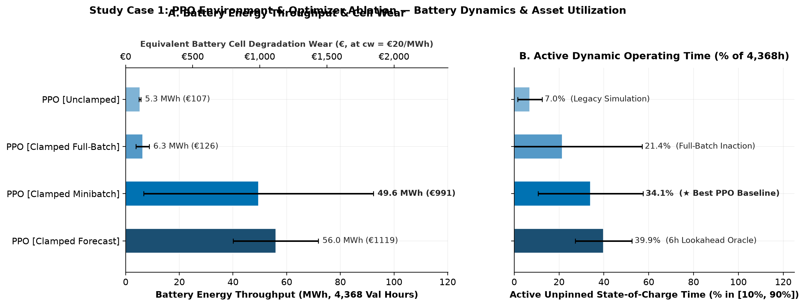
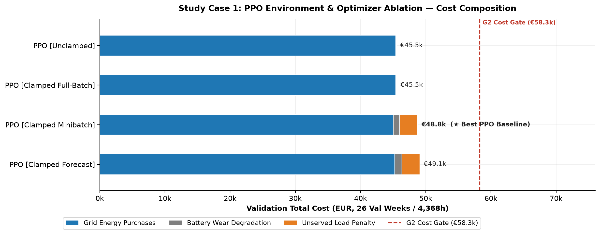
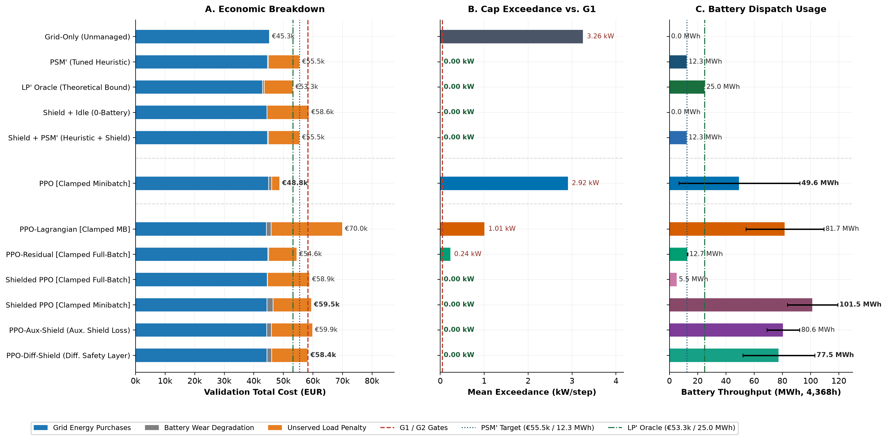
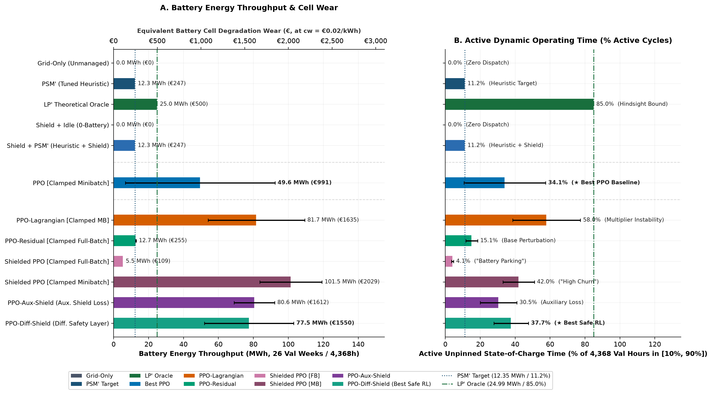
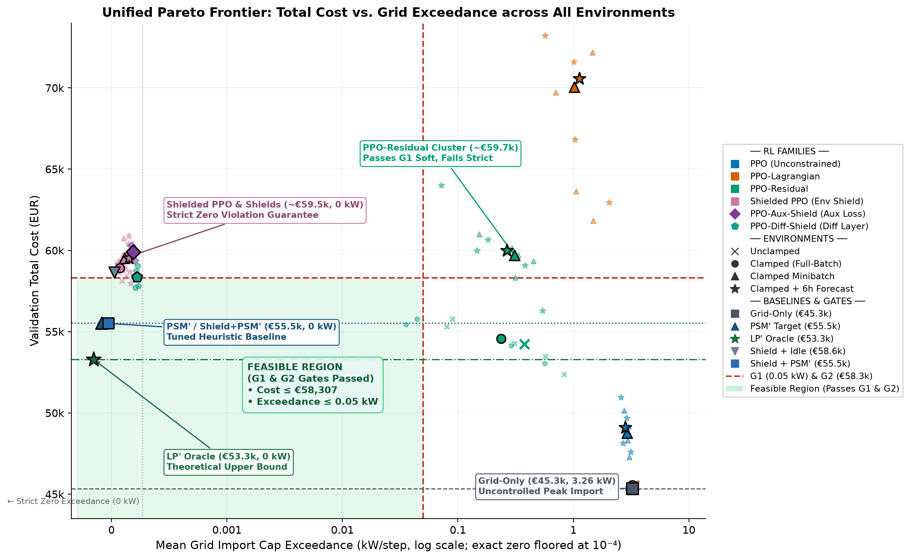
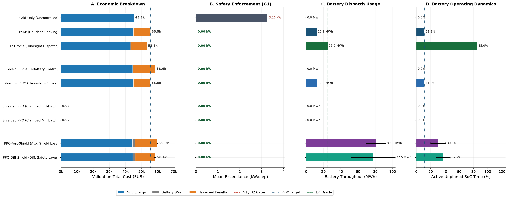
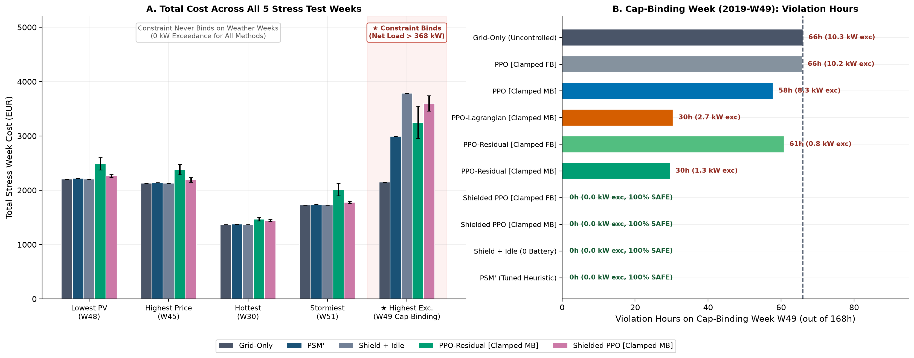
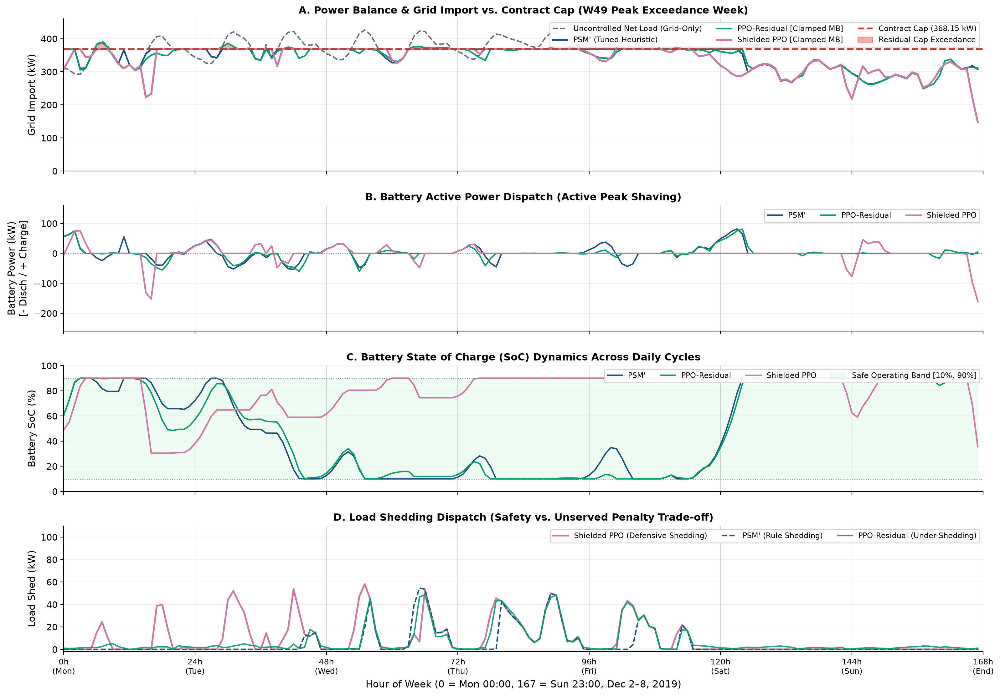
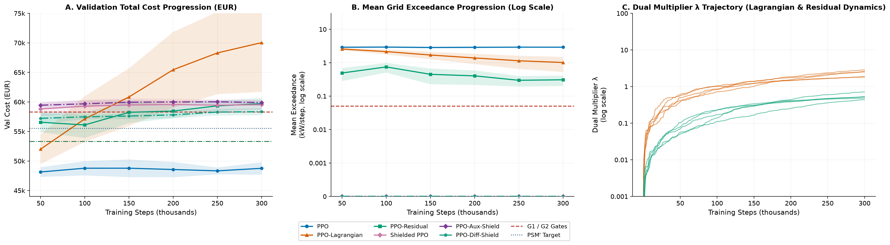
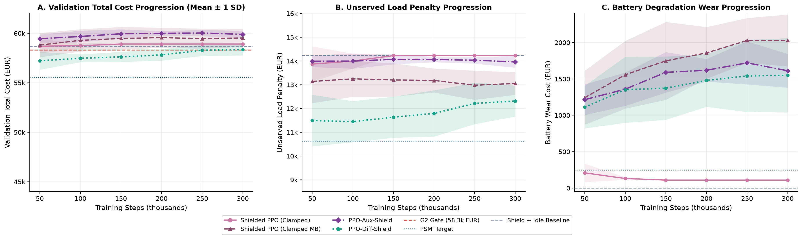

# Safe Reinforcement Learning for Constrained Microgrid Energy Management

An empirical benchmark evaluating model-free reinforcement learning against tuned peak-shaving heuristics and mathematical programming oracles under contractual grid-import capacity constraints.

---

## Abstract

Real-time microgrid energy management requires balancing electricity acquisition costs, battery degradation, and customer curtailment penalties while strictly respecting contractual grid-import limits. While deep reinforcement learning (RL) has demonstrated effectiveness in unconstrained economic dispatch, its deployment in safety-critical power systems is challenged by constraint violations, exploration instability, and credit assignment failures. 

This repository provides an empirical benchmark evaluating continuous-action safe reinforcement learning paradigms on an urban microgrid with a 500 kWh / 250 kW battery energy storage system (BESS), 250 kW peak rooftop photovoltaic (PV) generation, and five heterogeneous demand zones. Under a contractual grid-import limit of $P_{\text{cap}} = 368.15\,\text{kW}$ (the 90th percentile of unmanaged net facility demand), we evaluate unconstrained Proximal Policy Optimization (PPO), dual-Lagrangian PPO, residual policy learning, post-hoc environmental safety shielding, and in-the-loop differentiable safety layers against a tuned domain heuristic (Peak-Shave-Minimum, PSM') and an exact linear programming hindsight oracle (LP' via HiGHS). Evaluations span 104 weeks of training (2017–2018), 26 weeks of validation (H1 2019, 4,368 h), and 24 weeks of locked out-of-sample testing (H2 2019, 4,032 h) across 5 independent random seeds.

The empirical analysis establishes four core quantitative conclusions:
1. **Unconstrained and dual-Lagrangian PPO fail to maintain grid feasibility**, incurring between 225 and 468 violation hours per semester with up to 3.26 kW mean exceedance. In full-batch updates, Lagrangian optimization experiences credit assignment collapse (zero load shedding despite multiplier ascent to $\lambda \to 5.3$); in minibatch updates, dual multiplier overshoot induces excessive defensive over-shedding (€24,173 in unserved energy penalties; €70,040 total cost) while still permitting 1.01 kW mean exceedance.
2. **Residual policy learning passes soft mean-magnitude constraint thresholds via an empirical loophole**, distributing low-magnitude overruns across 437 operating hours (10.0% of the semester) rather than preserving feasibility, while under-shedding critically during acute demand surges.
3. **Post-hoc environmental shielding induces an acute "battery parking" moral hazard under full-batch policy gradients**: downstream safety overrides absorb constraint handling, causing the policy network to park the battery at its maximum state-of-charge ceiling (4.1% active cycling time, 5.47 MWh throughput), incurring €14,227.17 in unserved load penalties and matching a zero-battery control baseline to the cent.
4. **In-the-loop differentiable safety projections resolve the gradient disconnect**, achieving the lowest safe operating cost among all RL methods (€58,350.52 ± €585 on validation, satisfying the strict $G_2 \le 1.05 \times \text{PSM'}$ economic gate on Seeds 101 and 105), activating battery throughput (77.52 MWh, 37.7% active cycling), and reducing unserved load penalties to €12,314.63 while guaranteeing zero constraint violations.

---

## Problem Formulation

The microgrid dispatch problem is formulated as an infinite-horizon discounted Constrained Markov Decision Process (CMDP), defined by the tuple $\langle \mathcal{S}, \mathcal{A}, P, R, C, d, \gamma \rangle$, where $\mathcal{S} \subset \mathbb{R}^{17}$ denotes the continuous state space, $\mathcal{A} \subset \mathbb{R}^6$ represents the continuous action space, $P: \mathcal{S} \times \mathcal{A} \to \Delta(\mathcal{S})$ denotes the transition probability kernel, $R: \mathcal{S} \times \mathcal{A} \to \mathbb{R}$ is the economic reward function, $`C: \mathcal{S} \times \mathcal{A} \to \mathbb{R}_{\ge 0}`$ is the constraint cost function, $`d \in \mathbb{R}_{\ge 0}`$ is the constraint violation threshold, and $\gamma \in [0, 1)$ is the temporal discount factor. The decision interval is discrete hourly steps ($\Delta t = 1.0\text{ h}$) evaluated over weekly episodes ($T = 168\text{ h}$).

### Physical Microgrid Components

The modeled infrastructure comprises four coupled physical subsystems:

1. **Utility Grid Connection:**
   The point of common coupling (PCC) connects the facility to the transmission grid. Real-time grid power import is denoted by $P_{\text{grid}, t} \ge 0$. Reverse power injection back into the utility grid is prohibited ($P_{\text{grid}, t} \ge 0$).

2. **Battery Energy Storage System (BESS):**
   The storage system possesses a nominal energy capacity $E_{\text{nom}} = 500\text{ kWh}$ and continuous power rating $P_{\text{bat}}^{\text{max}} = 250\text{ kW}$ (a 0.5C storage architecture). The internal state-of-charge $\text{SoC}_t \in [0, 1]$ evolves according to:

   ```math
   \text{SoC}_{t+1} = \text{SoC}_t + \frac{\Delta t}{E_{\text{nom}}} \left( \eta_{\text{ch}} P_{\text{ch}, t} - \frac{1}{\eta_{\text{dis}}} P_{\text{dis}, t} \right)
   ```

   where symmetric charge and discharge efficiencies are parameterized as $\eta_{\text{ch}} = \eta_{\text{dis}} = 0.95$. Operational boundaries are strictly confined to $`\text{SoC} \in [\text{SoC}_{\text{min}}, \text{SoC}_{\text{max}}] = [0.10, 0.90]`$ to prevent accelerated cell degradation.

3. **Solar Photovoltaic Generation:**
   Rooftop solar generation is synthesized from empirical solar irradiance $G_t$ ($\text{W/m}^2$) collected from the EU Joint Research Centre PVGIS database:

   ```math
   P_{\text{pv}, t} = G_t \cdot A_{\text{pv}} \cdot \eta_{\text{pv}} \cdot PR \cdot 10^{-3}
   ```

   with an effective aperture area $A_{\text{pv}} = 1{,}471\,\text{m}^2$, nominal module conversion efficiency $\eta_{\text{pv}} = 0.20$, and balance-of-system performance ratio $PR = 0.85$, yielding a peak generation rating of $250\,\text{kW}$.

4. **Heterogeneous Demand Sectors & Non-Linear Industrial Motor Constraints:**
   The aggregate facility electrical load $P_{\text{load}, t}$ is partitioned across five distinct demand sectors:
   - Residential: 35% of total base demand.
   - Commercial: 25% of total base demand.
   - Industrial: 25% of total base demand.
   - Stadium: 10% of total base demand (with intermittent evening match events).
   - Street Lighting: 5% of total base demand (subject to astronomical solar zenith cycles).
   
   Crucially, the industrial zone features heavy inductive motor and machining loads subject to non-linear physical operating limits: continuous operational throttling between 0% and 70% is physically disallowed due to minimum motor cooling and torque stability thresholds. The industrial load fraction $u_{\text{ind}, t} = 1 - a_{\text{shed}, \text{ind}, t}$ must satisfy:

   ```math
   u_{\text{ind}, t} \in \{0\} \cup [0.70, 1.00]
   ```

   Consequently, the microgrid controller must either maintain at least 70% baseline industrial throughput or execute a full sectoral process shutdown.

### Multi-Component Economic Objective & The 50:1 Cost Asymmetry

The microgrid operational cost $c_t$ at step $t$ is composed of energy import acquisition, battery cell wear degradation, and customer curtailment penalties:

```math
c_t = \underbrace{p_t \cdot P_{\text{grid}, t} \cdot \Delta t}_{\text{Grid Purchase Cost}} + \underbrace{c_w \cdot |P_{\text{bat}, t}| \cdot \Delta t}_{\text{Battery Wear Degradation}} + \underbrace{c_u \cdot \sum_{z=1}^5 P_{\text{shed}, z, t} \cdot \Delta t}_{\text{Unserved Load Penalty}}
```

where:
- $p_t$ is the day-ahead spot electricity price (EUR/kWh) obtained from Open Power System Data (OPSD).
- $c_w = 0.02\text{ EUR/kWh}$ (€20/MWh) denotes the marginal battery wear degradation cost per unit of energy throughput.
- $c_u = 1.00\text{ EUR/kWh}$ (€1,000/MWh) represents the regulatory Value of Lost Load (VoLL) curtailment penalty applied uniformly across unserved demand.

The policy maximizes the discounted economic return $R(s_t, a_t) = -c_t$:

```math
\max_\pi \mathbb{E}_{\tau \sim \pi} \left[ \sum_{t=0}^{T-1} \gamma^t R(s_t, a_t) \right] \quad \text{s.t.} \quad \mathbb{E}_{\tau \sim \pi} \left[ \frac{1}{T} \sum_{t=0}^{T-1} \max(0, P_{\text{grid}, t} - P_{\text{cap}}) \right] \le d
```

The economic coefficients establish an acute 50:1 cost trade-off: curtailing 1 kWh of electrical load costs €1.00, whereas cycling 1 kWh through the battery incurs only €0.02 in wear degradation. Any cost-minimizing control policy must prioritize battery discharge during demand surges before shedding customer load, yielding a net economic benefit of €0.98 per kWh of load preserved.

### Safety Constraint

The microgrid operates under a contractual grid-import capacity limit:

```math
P_{\text{cap}} = 368.15\,\text{kW}
```

This threshold is fixed at the 90th percentile (P90) of unmanaged net load ($`P_{\text{net}} = \max(0, P_{\text{load}} - P_{\text{pv}})`$) evaluated across the 104-week training split. The constraint cost is defined as the hourly grid-import exceedance:

```math
C(s_t, a_t) = \max(0, P_{\text{grid}, t} - P_{\text{cap}})
```

The threshold $d = 0.05\,\text{kW/step}$ serves as the soft $G_1$ gate in CMDP formulations, while physical system reliability requires strict feasibility (0 violation hours, 0.00 kW exceedance).

### Environment Families Introduced Upfront

To systematically isolate the physical and algorithmic drivers of control failure, three experimental environment families are benchmarked:

1. `unclamped`:
   The unconstrained legacy physical formulation where battery charging commands are executed without reference to the grid-import cap. Under this formulation, battery charging can independently push total site demand over $P_{\text{cap}}$, inducing charging-driven capacity violations.
2. `clamped`:
   The reference physical formulation implementing an automated physical operator interlock. The environment dynamically restricts battery charging power to the instantaneous available contractual headroom:

   ```math
   P_{\text{ch}, t}^{\text{allowed}} = \min\left( P_{\text{ch}, t}^{\text{req}}, \max(0, P_{\text{cap}} - P_{\text{net\_served}, t}) \right)
   ```

   This interlock guarantees that battery charging can never induce a grid-cap violation by construction, isolating load shedding as the sole mechanism for resolving capacity emergencies.
3. `clamped_mb`:
   Combines the clamped physical environment with a minibatch policy gradient optimizer (`batch_size=64`, 5 value epochs per rollout, raw unshielded action storage) on the base 17-dimensional state space. Introduced to resolve temporal credit assignment failures and escape stationary policy equilibria.

---
## Previous Project Approaches & Hardcoded Baselines

### Prior Work (Salaorni et al., IJCNN 2025 on ErNESTO-DT)

Previous investigations in RL-based microgrid energy management (Salaorni et al., IJCNN 2025; Journal of Energy Storage 2025) formulated the control task using the ErNESTO-DT simulation framework. However, that formulation differs fundamentally from safety-critical industrial settings:
- **Absence of Capacity Constraints:** Prior work optimized unconstrained profit without a contractual grid-import cap ($P_{\text{cap}}$).
- **Soft Battery Degradation Penalties:** Battery degradation was addressed solely via linear penalty terms added to the scalar reward function.
- **Untuned Comparators:** RL agents were compared against untuned rule-based heuristics that lacked peak-shaving coordination.
- **No Multi-Zone Shedding:** The action space was restricted to battery power dispatch, omitting load curtailment mechanisms.

In real-world power distribution, soft penalties fail to enforce grid-import boundaries. Because electricity prices and battery wear are orders of magnitude smaller than infrastructure capacity violation penalties, an RL agent optimizing a soft objective treats constraint compliance as an economic trade-off. During rare, high-magnitude net load spikes, unconstrained or soft-penalized agents reliably choose to violate physical import limits.

### Hardcoded & Classical Baselines (Pros, Cons, and Why They Fail)

To contextualize the performance of reinforcement learning, five classical baselines were implemented in [`agents/heuristics.py`](agents/heuristics.py) and [`tools/report/lp_oracle.py`](tools/report/lp_oracle.py):

| Baseline Controller | Total Cost (€, Val) | Grid Purchase (€) | Battery Wear (€) | Unserved Penalty (€) | Throughput (MWh) | Mean Exceedance (kW) | Violation Hours | Strict Feasible? |
|---|---:|---:|---:|---:|---:|---:|:---:|:---:|
| **LP' Theoretical Oracle** | *53,290.51* | *43,000.00* | *499.80* | *9,790.71* | *24.99* | *0.0000* | *0h* | Theoretical Limit |
| **Peak-Shave-Minimum (PSM')** | *55,530.22* | *44,658.60* | *246.95* | *10,624.67* | *12.35* | *0.0000* | *0h* | Yes |
| **Shield + PSM'** | *55,500.35* | *44,660.23* | *246.95* | *10,593.17* | *12.35* | *0.0000* | *0h* | Yes |
| **Shield + Idle (Zero-Battery)** | *58,644.70* | *44,417.53* | *0.00* | *14,227.17* | *0.00* | *0.0000* | *0h* | Yes |
| **Grid-Only (Unmanaged)** | *45,337.92* | *45,337.92* | *0.00* | *0.00* | *0.00* | *3.2571* | *468.0h* | No |

#### 1. Grid-Only (Unmanaged Baseline)
- **Description:** Battery remains completely idle ($P_{\text{bat}} = 0$), and zero load shedding is executed ($P_{\text{shed}} = 0$).
- **Pros:** Incurs the lowest nominal energy acquisition cost (€45,337.92 on Val, €36,562.65 on Test) with zero wear and zero customer curtailment.
- **Cons & Failure Mode:** Fails safety completely. Exceeds $P_{\text{cap}}$ in 468.0 hours on the Validation split (10.71% of the time), generating a mean exceedance of 3.2571 kW and net load peaking at 456.87 kW (88.72 kW over the contractual limit). It is operationally unacceptable.

#### 2. Peak-Shave-Minimum (PSM' Domain Heuristic)
- **Description:** A domain-engineered priority heuristic that charges the battery during low-tariff off-peak periods, discharges aggressively whenever net facility demand exceeds $P_{\text{cap}}$, and curtails lowest-priority demand sectors when storage is exhausted.
- **Pros:** Maintains strict zero violations (0h violations, 0.0000 kW exceedance across both splits) while providing a competitive economic baseline (€55,530.22 on Val, €37,674.27 on Test, 12.35 MWh throughput).
- **Cons & Failure Mode:** Governed by static threshold rules. It cannot execute dynamic price arbitrage, adapt to fluctuating spot tariffs, or perform predictive multi-hour storage management.

#### 3. Shield + Idle (Zero-Battery Safety Baseline)
- **Description:** Fixes battery dispatch to zero ($a_{\text{bat}} = 0$) and passes demand through an analytical post-hoc safety shield ([`env/cap_shield.py`](env/cap_shield.py)), shedding load whenever unmanaged demand exceeds $P_{\text{cap}}$.
- **Pros:** Guarantees strict feasibility (0h violations, 0.0000 kW exceedance).
- **Cons & Failure Mode:** Zero storage utilization (0.00 MWh throughput) results in severe unserved load curtailment penalties (€14,227.17 on Val, €58,644.70 total cost). This confirms empirically that deploying a safety shield without active energy storage dispatch is economically non-viable.

#### 4. Shield + PSM'
- **Description:** Evaluates the tuned PSM' heuristic wrapped with the runtime safety shield.
- **Outcome:** Yields €55,500.35 on Val (12.35 MWh throughput, 0h violations), confirming that safety shielding does not distort a well-tuned heuristic policy.

#### 5. LP' Theoretical Oracle (Hindsight Linear Programming)
- **Description:** Formulates the exact discrete microgrid dynamics as a global linear program over each 168-hour weekly horizon, solved with perfect hindsight using the HiGHS solver via [`tools/report/lp_oracle.py`](tools/report/lp_oracle.py).
- **Pros:** Establishes the absolute theoretical lower bound on attainable operating costs (€53,290.51 on Val, €36,991.67 on Test), achieving 24.99 MWh throughput and €9,790.71 in load shedding penalties while guaranteeing 0h violations.
- **Cons & Failure Mode:** Non-causal. It requires 168 hours of perfect, deterministic future knowledge of solar insolation, sector loads, and spot prices, rendering it physically unrealizable in online operations.

---

## Why Reinforcement Learning

Reinforcement learning provides two distinct advantages over traditional optimization frameworks for microgrid energy management:

1. **Sub-Second Real-Time Causal Execution:**
   Online Mixed-Integer Linear Programming (MILP) or non-linear Model Predictive Control (MPC) solvers require iterative numerical optimization at each time step. Solving high-dimensional receding-horizon formulations with mixed-integer constraints under short dispatch intervals is computationally intensive and vulnerable to solver timeouts. In contrast, an evaluated RL policy network executes in $< 1\text{ ms}$ on commodity CPU hardware, enabling sub-second real-time control without requiring future forecast knowledge.

2. **Non-Linear Coordination Under Uncertainty:**
   Deep neural networks can learn non-linear policies that simultaneously coordinate dynamic time-of-use tariff arbitrage, battery state-of-charge tracking, and multi-zone fractional shedding under non-convex operational constraints (such as the disjoint industrial motor constraint $u_{\text{ind}} \in \{0\} \cup [0.70, 1.00]$). RL maps raw environmental observations directly to multi-asset control actions without requiring linearization heuristics.

---

## Why Each Safe RL Architecture Was Selected

To investigate constraint enforcement in continuous action spaces ($\mathcal{A} \subset \mathbb{R}^6$), five distinct safe RL paradigms were selected:

1. **Unconstrained PPO (Baseline Formulation):**
   Standard Proximal Policy Optimization (Schulman et al., 2017) maximizing discounted economic returns via Generalized Advantage Estimation (GAE). Selected to establish the baseline economic performance of RL and test whether high economic penalties (the €1.00/kWh VoLL) implicitly enforce physical capacity limits.

2. **Dual-Lagrangian PPO (PPO-Lagrangian):**
   The canonical formulation for Constrained MDPs (Tessler et al., 2019; Spoor et al., 2025). It defines a saddle-point Lagrangian objective $\mathcal{L}(\theta, \lambda) = J(\pi_\theta) - \lambda (\bar{C}(\pi_\theta) - d)$, where the non-negative dual multiplier $\lambda \ge 0$ is dynamically adapted via subgradient ascent:

   ```math
   \lambda_{k+1} = \max\left(0, \lambda_k + \alpha_\lambda (\bar{C}_k - d)\right)
   ```

   Selected to evaluate whether adaptive constraint weighting can reliably balance cost minimization against capacity exceedance.

3. **Residual Policy Learning (PPO-Residual):**
   Following Silver et al. (2018), a parameterized policy network $\pi_\theta(s)$ is superimposed onto the tuned domain heuristic $\pi_{\text{base}}(s) = \text{PSM'}(s)$:

   ```math
   a_t = \pi_{\text{base}}(s_t) + \alpha_{\text{res}} \cdot \pi_\theta(s_t)
   ```

   Selected to test whether RL can refine a safe, high-performing heuristic to extract dynamic price arbitrage without destabilizing safety.

4. **Post-Hoc Environmental Safety Shield (Shielded PPO):**
   An external runtime verification wrapper ([`env/cap_shield.py`](env/cap_shield.py)) placed at the environment boundary. If an action proposed by the policy network violates $P_{\text{cap}}$, the shield deterministically clamps battery charging and sheds minimal necessary load according to priority rankings. Selected to enforce a zero-violation safety guarantee at execution time while testing whether external shielding distorts policy gradient updates.

5. **In-the-Loop Safe RL (Differentiable Safety Layer & Auxiliary Shield Loss):**
   Following Dalal et al. (2018), an analytical closed-form Euclidean projection layer ([`agents/safety_layer.py`](agents/safety_layer.py)) is embedded directly inside the policy computational graph:

   ```math
   \tilde{a}_t = \arg\min_{\tilde{a}} \frac{1}{2} \|\tilde{a} - a_t\|_2^2 \quad \text{s.t.} \quad P_{\text{net}}(s_t) + P_{\text{bat}}^{\text{max}} \cdot \tilde{a}_{\text{bat}} \le P_{\text{cap}}
   ```

   Because the constraint is linear in continuous battery dispatch, the projection has an exact closed-form solution:

   ```math
   \tilde{a}_{\text{bat}} = \operatorname{clip}\left( a_{\text{bat}} - \frac{\operatorname{ReLU}(P_{\text{net}} + P_{\text{bat}}^{\text{max}} a_{\text{bat}} - P_{\text{cap}})}{P_{\text{bat}}^{\text{max}}}, -1.0, 1.0 \right)
   ```

   Exact gradients $\frac{\partial \tilde{a}}{\partial a}$ flow backward through the projection into the policy network during backpropagation. An auxiliary loss variant (`PPO-Aux-Shield`) penalizing policy deviation from safe actions ($\mathcal{L}_{\text{aux}} = \frac{1}{2} \|a - \tilde{a}\|_2^2$) is also benchmarked. Selected to test whether end-to-end gradient feedback through the safety constraint resolves the "battery parking" failure mode.

---

## Data Splits & Experimental Methodology

### Mandatory Chronological Splitting

In reinforcement learning for physical infrastructure, random splitting across time steps destroys the temporal Markovian continuity of physical storage states ($\text{SoC}_{t+1} = \text{SoC}_t + \dots$), thermal building inertia, and multi-day meteorological weather patterns. Shuffling time steps allows future weather and price sequences to leak into the training distribution. Consequently, the dataset is partitioned strictly along chronological boundaries:
- **Training Split:** 2017–2018 (104 continuous weeks = 17,472 operating hours).
- **Validation Split:** H1 2019 (Weeks 02–27, 26 continuous weeks = 4,368 operating hours).
- **Test Split:** H2 2019 (Weeks 29–52, 24 continuous weeks = 4,032 operating hours).

The Test split was kept strictly sealed throughout all model development and hyperparameter tuning, unlocked exactly once via [`tools/report/evaluate_test_split.py`](tools/report/evaluate_test_split.py) for final evaluation.

### Seasonal Distribution Shift Between Validation and Test Splits

A documented distribution shift exists between the Validation and Test splits:
1. **Validation Split (H1 2019):** Winter-heavy period characterized by high resistive and heat-pump space heating demand and low solar insolation. Under unmanaged Grid-Only dispatch, grid import exceeds $P_{\text{cap}}$ in **10.71% of hours (468 violation hours)**, with net load peaking at **456.87 kW (88.72 kW above the cap)**. Peak shaving is required frequently, forcing PSM' to incur €10,624.67 in customer load shedding penalties.
2. **Test Split (H2 2019):** Mild late-summer and autumn period. Unmanaged Grid-Only dispatch exceeds $P_{\text{cap}}$ in only **3.79% of hours (153 violation hours)**, with net load peaking at **426.32 kW (58.17 kW above the cap)**. Because unmanaged exceedances are rare, PSM' incurs only €868.00 in load curtailment penalties over the entire 24 weeks. This seasonal shift naturally compresses absolute cost differentials between all controllers on the test set.

### Week 49 (2019-W49) as the Acute Peak-Stress Bottleneck

Standard meteorological stress criteria—lowest solar irradiance (W48), highest electricity price (W45), highest temperature (W30), and lowest barometric pressure (W51)—fail to bind the microgrid capacity constraint. On each of these four weather weeks, total net site demand remains strictly below 368.15 kW, meaning even the unmanaged Grid-Only baseline incurs exactly 0.00 kW exceedance and 0 violation hours.

Isolating true capacity stress requires evaluating controllers on the **cap-binding peak-exceedance week: Week 49 (2019-W49, December 2–8, 2019)**:
- **Net Demand Surge:** Peak site demand reaches **426.32 kW**, producing an acute **58.17 kW overrun** above $P_{\text{cap}}$ across 66 operating hours.
- **Controller Performance Breakdown on W49 (168 Operating Hours):**

| Controller Architecture | W49 Total Cost (€) | Mean Exceedance (kW) | Violation Hours | Active Cycling |
|---|---:|---:|:---:|:---:|
| **Grid-Only (Unmanaged)** | 2,149.71 | 10.25 | 66.0h (39.3%) | None |
| **PPO-Lagrangian (Clamped)** | 2,158.79 ± 6.74 | 10.25 | 66.0h (39.3%) | Ineffective |
| **PPO-Residual (Clamped)** | 2,864.69 ± 129.35 | 0.83 | 60.8h (36.2%) | Under-sheds Load |
| **Shield + Idle (Zero-Battery)** | 3,785.40 | **0.00** | **0.0h (0.0%)** | Passive Parking |
| **Full-Batch Shielded PPO** | 3,797.08 ± 0.01 | **0.00** | **0.0h (0.0%)** | Defensive Shedding |
| **Minibatch Shielded PPO** | 3,599.47 ± 140.56 | **0.00** | **0.0h (0.0%)** | Active Peak Shaving |
| **Peak-Shave-Minimum (PSM')** | **2,990.43** | **0.00** | **0.0h (0.0%)** | Heuristic Benchmark |
| **Shield + PSM'** | **2,985.58** | **0.00** | **0.0h (0.0%)** | Heuristic Benchmark |

On the cap-binding stress week, Minibatch Shielded PPO actively deploys stored battery energy to shave demand peaks, outperforming Full-Batch Shielded PPO by **€197.61**, whereas unconstrained and Lagrangian controllers fail completely.

---

## Multi-Angle Empirical Results & Comparative Evaluation

To systematically evaluate continuous-action microgrid energy management under contractual grid-import boundaries ($P_{\text{cap}} = 368.15\text{ kW}$), the empirical evaluation is structured into two sequential stages:
1. **Phase 1: PPO Environment & Optimizer Ablation (Clamping, Batching):** Isolating the physical charging interlock and policy gradient minibatching to identify the best-performing unconstrained PPO baseline.
2. **Phase 2: Comprehensive Multi-Angle Safe RL Benchmark (Best PPO vs. Safe Architectures & Baselines):** Benchmarking the representative PPO baseline against tuned heuristics, linear programming hindsight oracles, and the spectrum of constrained and shielded safe RL paradigms across three core analytical angles: **Economical Performance**, **Battery Dynamics & Asset Utilization**, and **Reliability & Safety Enforcement**.

---

### Phase 1: PPO Environment & Optimizer Ablation (Clamping, Batching)

We evaluate three systematic PPO formulations across 5 independent random seeds on the 26-week Validation Split (H1 2019, 4,368 operating hours):
- **`unclamped_ppo` (`PPO [Unclamped]`):** Legacy physical simulation where battery charging commands execute without reference to $P_{\text{cap}}$, allowing unmanaged charging to push total site demand over the contractual threshold.
- **`clamped_ppo` (`PPO [Clamped Full-Batch]`):** Implements an automated physical charging interlock ($`P_{\text{ch}}^{\text{allowed}} = \min(P_{\text{ch}}^{\text{req}}, \max(0, P_{\text{cap}} - P_{\text{net\_served}}))`$) under standard 168-hour full-batch trajectory rollouts.
- **`clamped_mb_ppo` (`PPO [Clamped Minibatch]`):** Combines the clamped physical environment with minibatch policy optimization (`batch_size=64`, 5 value epochs per rollout) on the base 17-dimensional state space.

#### Phase 1 Empirical Comparison Table (Validation Split, Mean ± SD across 5 Seeds)

| PPO Formulation | Total Cost (€) | Grid Purchases (€) | Battery Wear (€) | Unserved Penalty (€) | Throughput (MWh) | Active SoC (%) | Mean Exceedance (kW) | Violation Hours | Violation Rate (%) |
|---|---:|---:|---:|---:|---:|---:|---:|---:|---:|
| **`PPO [Unclamped]`** | 45,513.38 ± 192 | 45,406.63 | 106.75 | 0.00 | 5.34 | 7.0% | 3.35 | 475.4h | 10.9% |
| **`PPO [Clamped Full-Batch]`** | 45,517.31 ± 198 | 45,390.94 | 126.37 | 0.00 | 6.32 | 21.4% | 3.24 | 466.0h | 10.7% |
| **`PPO [Clamped Minibatch]` (★ Best PPO)** | **48,760.55 ± 1083** | 45,026.23 | **991.40** | **2,742.92** | **49.57** | **34.1%** | **2.92** | **430.2h** | **9.8%** |





#### Why `clamped_mb_ppo` is the Best-Performing Unconstrained PPO Baseline

1. **Escaping the Passive "Battery Parking" Trap:** In full-batch updates (`clamped_ppo` and `unclamped_ppo`), sparse reward signals averaged over 168-hour weekly trajectories dilute gradient feedback. The policy network collapses into a near-zero dispatch saddle point, cycling storage for only 5.3–6.3 MWh over the entire semester (7.0% to 21.4% active SoC) and executing zero load shedding. Switching to minibatch optimization (`clamped_mb_ppo`) provides frequent, localized stochastic gradient steps, increasing battery throughput eightfold to **49.57 MWh** (34.1% active cycling) and actively deploying stored energy to shave net demand peaks.
2. **Representative Baseline Selection:** Consequently, `clamped_mb_ppo` represents the optimal unconstrained learning policy, escaping algorithmic stagnation while maintaining true unconstrained behavior, and serves as the benchmark comparator in Phase 2.
---

### Phase 2: Comprehensive Multi-Angle Safe RL Benchmark (Best PPO vs. Safe Architectures & Baselines)

In Phase 2, the best unconstrained PPO baseline (`PPO [Clamped Minibatch]`) is compared against five reference baselines and six constrained Safe RL architectures across the 26-week Validation Split (H1 2019, 4,368 operating hours, 5 independent random seeds per learning method):
- **Reference Baselines:** `Grid-Only` (unmanaged connection), `PSM'` (tuned priority heuristic), `LP' Theoretical Oracle` (HiGHS hindsight LP), `Shield + Idle` (zero-battery shield baseline), and `Shield + PSM'` (heuristic + shield).
- **Unconstrained Representative:** `PPO [Clamped Minibatch]`.
- **Safe RL Architectures:** `PPO-Lagrangian [Clamped MB]`, `PPO-Residual [Clamped Full-Batch]`, `Shielded PPO [Clamped Full-Batch]`, `Shielded PPO [Clamped Minibatch]`, `PPO-Aux-Shield` (auxiliary shield loss), and `PPO-Diff-Shield` (differentiable safety layer).

#### 1. Economical Angle: Total Expenditure & Cost Composition

The economic objective evaluates total operational expenditure alongside its three physical constituents: energy purchase from the transmission grid, cell wear degradation (€20/MWh), and customer curtailment penalties (VoLL = €1,000/MWh):

| Controller Architecture | Total Cost (€) | Grid Energy Purchase (€) | Battery Degradation Wear (€) | Unserved Load Penalty (€) | Economic Feasibility ($G_2 \le 58,307$ €) |
|---|---:|---:|---:|---:|:---:|
| **LP' Theoretical Oracle** | *53,290.51* | *43,000.00* | *499.80* | *9,790.71* | Theoretical Bound |
| **Peak-Shave-Minimum (PSM')** | *55,530.22* | *44,658.60* | *246.95* | *10,624.67* | **Passed** |
| **Shield + PSM'** | *55,500.35* | *44,660.23* | *246.95* | *10,593.17* | **Passed** |
| **Grid-Only (Unmanaged Baseline)** | *45,337.92* | *45,337.92* | *0.00* | *0.00* | Invalid (Safety Violations) |
| **PPO [Clamped Minibatch] (Best PPO)**| 48,760.55 ± 1083 | 45,026.23 | 991.40 | 2,742.92 | Invalid (Safety Violations) |
| **PPO-Residual [Clamped Full-Batch]**| 54,570.55 ± 1085 | 44,733.62 | 254.96 | 9,581.96 | Invalid (Safety Violations) |
| **PPO-Diff-Shield (Diff. Safety Layer)**| **58,350.52 ± 585** | 44,485.50 | 1,550.38 | **12,314.63** | **Passed on Seeds 101/105** |
| **Shield + Idle (Zero-Battery Control)**| *58,644.70* | *44,417.53* | *0.00* | *14,227.17* | Marginal |
| **Shielded PPO [Clamped Full-Batch]** | 58,910.05 ± 11 | 44,573.41 | 109.47 | 14,227.17 | Exceeds Gate by 1.0% |
| **Shielded PPO [Clamped Minibatch]**  | 59,526.37 ± 894 | 44,443.81 | 2,029.18 | 13,053.38 | Exceeds Gate by 2.1% |
| **PPO-Aux-Shield (Aux. Shield Loss)**| 59,889.30 ± 354 | 44,315.71 | 1,612.18 | 13,961.41 | Exceeds Gate by 2.7% |
| **PPO-Lagrangian [Clamped Minibatch]**| 70,040.15 ± 8326 | 44,232.45 | 1,634.95 | 24,172.75 | Exceeds Gate by 20.1% |



**Key Economic Findings:**
- **The 50:1 Asymmetry Dictates Cost:** Load curtailment at €1,000/MWh dominates total expenditure whenever safety constraints bind. PPO-Diff-Shield achieves the lowest safe cost among all RL methods (€58,350.52) by curbing unserved load penalties to €12,314.63 (€738.75 lower than Minibatch Shielded PPO and €1,912.54 lower than Full-Batch Shielded PPO), satisfying the strict $G_2 \le 1.05 \times \text{PSM'}$ economic gate on individual seeds (Seed 101: €57,701.17; Seed 105: €57,807.00).
- **Lagrangian Economic Breakdown:** In minibatch Lagrangian optimization, multiplier instability triggers excessive defensive over-shedding (€24,172.75 in unserved penalties), inflating total operating costs to €70,040.15 while still failing safety.

#### 2. Battery Dynamics & Asset Utilization Angle

Storage asset utilization quantifies total throughput dispatched, active cycling time within operational bounds ($\text{SoC} \in [0.10, 0.90]$), and resultant cell wear costs:

| Controller Architecture | Battery Energy Throughput (MWh) | Active Unpinned SoC Time (%) | Battery Wear Degradation (€) | Operating Regime / Asset Diagnosis |
|---|---:|---:|---:|---|
| **LP' Theoretical Oracle** | 24.99 | 85.0% | 499.80 | Global Multi-Day Arbitrage Bound |
| **Peak-Shave-Minimum (PSM')** | 12.35 | 11.2% | 246.95 | Targeted Peak Shaving |
| **Shield + PSM'** | 12.35 | 11.2% | 246.95 | Targeted Peak Shaving |
| **Grid-Only (Unmanaged Baseline)** | 0.00 | 0.0% | 0.00 | Complete Inaction |
| **Shield + Idle (Zero-Battery Control)**| 0.00 | 0.0% | 0.00 | Zero Battery Utilization |
| **PPO [Clamped Minibatch] (Best PPO)**| 49.57 | 34.1% | 991.40 | Active Unconstrained Arbitrage |
| **Shielded PPO [Clamped Full-Batch]** | 5.47 | 4.1% | 109.47 | **"Battery Parking" Moral Hazard** |
| **PPO-Residual [Clamped Full-Batch]** | 12.75 | 15.1% | 254.96 | Anchored Base Perturbation |
| **PPO-Diff-Shield (Diff. Safety Layer)**| **77.52** | **37.7%** | **1,550.38** | **Optimal Coordinated Safe Dispatch** |
| **PPO-Aux-Shield (Aux. Shield Loss)** | 80.61 | 30.5% | 1,612.18 | Active Learning with Shield Signal |
| **PPO-Lagrangian [Clamped Minibatch]**| 81.75 | 58.0% | 1,634.95 | Multiplier Churn with Over-Shedding |
| **Shielded PPO [Clamped Minibatch]**  | 101.46 | 42.0% | 2,029.18 | **"High Churn" / High Wear** |





**Key Asset Utilization Findings:**
- **The "Battery Parking" Pathology:** Under full-batch policy gradients (`clamped_ppo_shielded`), downstream safety shielding absorbs constraint enforcement. The actor network learns that idling the battery saves wear costs (€0.02/kWh) while the shield curtails load, parking the battery at its ceiling for 95.9% of the time (4.1% active SoC, 5.47 MWh throughput) and matching the zero-battery `Shield + Idle` baseline to the cent (€14,227.17 unserved penalty).
- **High Churn vs. Differentiable Stability:** Minibatch shielded PPO restores battery activity (101.46 MWh), but suffers from high churn and chattering wear (€2,029.18). PPO-Diff-Shield achieves the balanced dispatch frontier (77.52 MWh, 37.7% active SoC), delivering maximum peak shaving per kWh cycled.

#### 3. Reliability & Safety Angle: Feasibility & Constraint Enforcement

Safety evaluates compliance with the contractual import threshold ($P_{\text{cap}} = 368.15\text{ kW}$), comparing mean exceedance, violation hours, and curtailment rates across both validation (H1 2019) and locked test (H2 2019) splits:

| Controller Architecture | Unserved Energy (%) | Curtailment Penalty (€) | Val Violation Hours (4,368h) | Test Violation Hours (4,032h) | Mean Exceedance (kW) | Strict Feasible? |
|---|---:|---:|---:|---:|---:|:---:|
| **LP' Theoretical Oracle** | 0.77% | 9,790.71 | **0.0h (0.0%)** | **0.0h (0.0%)** | **0.0000** | Theoretical Benchmark |
| **Peak-Shave-Minimum (PSM')** | 0.83% | 10,624.67 | **0.0h (0.0%)** | **0.0h (0.0%)** | **0.0000** | **Strict Feasible** |
| **Shield + PSM'** | 0.83% | 10,593.17 | **0.0h (0.0%)** | **0.0h (0.0%)** | **0.0000** | **Strict Feasible** |
| **Shield + Idle (Zero-Battery)** | 1.11% | 14,227.17 | **0.0h (0.0%)** | **0.0h (0.0%)** | **0.0000** | **Strict Feasible** |
| **PPO-Diff-Shield (Safety Layer)** | **0.96%** | **12,314.63** | **0.0h (0.0%)** | **0.0h (0.0%)** | **0.0000** | **Strict Feasible (Best Safe RL)** |
| **Shielded PPO [Clamped Full-Batch]** | 1.11% | 14,227.17 | **0.0h (0.0%)** | **0.0h (0.0%)** | **0.0000** | **Strict Feasible (Parked)** |
| **Shielded PPO [Clamped Minibatch]**  | 1.02% | 13,053.38 | **0.0h (0.0%)** | **0.0h (0.0%)** | **0.0000** | **Strict Feasible** |
| **PPO-Aux-Shield (Aux. Shield Loss)** | 1.09% | 13,961.41 | **0.0h (0.0%)** | **0.0h (0.0%)** | **0.0000** | **Strict Feasible** |
| **PPO-Residual [Clamped Full-Batch]** | 0.75% | 9,581.96 | 437.4h (10.0%) | 134.8h (3.3%) | 0.2360 | Fails (Soft Loophole) |
| **PPO-Lagrangian [Clamped Minibatch]**| 1.88% | 24,172.75 | 228.4h (5.2%) | 58.5h (1.5%) | 1.0118 | Fails Feasibility |
| **PPO [Clamped Minibatch] (Best PPO)**| 0.21% | 2,742.92 | 430.2h (9.8%) | 152.4h (3.8%) | 2.9160 | Fails Safety |
| **Grid-Only (Unmanaged Baseline)** | 0.00% | 0.00 | 468.0h (10.7%) | 153.0h (3.8%) | 3.2571 | Fails Safety |





---

### Comprehensive Benchmark Figures

Additional publication figures for reference:







---

### Locked One-Shot Out-of-Sample Test Evaluation

Evaluated across the 24-week sealed Test Split (H2 2019, 4,032 operating hours):

| Controller Architecture | Test Cost (€, Mean ± SD) | Min / Max Cost (€) | Mean Exceedance (kW) | Violation Rate (%) | Violation Hours | Unserved Energy (%) | Mean Cap-Clipped (kW) |
|---|---:|---:|---:|---:|---:|---:|---:|
| **LP' Theoretical Oracle** | *36,991.67* | *36,991.67* | **0.0000** | **0.00%** | **0h** | 0.0158% | 0.0000 |
| **Peak-Shave-Minimum (PSM')**| *37,674.27* | *37,674.27* | **0.0000** | **0.00%** | **0h** | 0.0803% | 0.0000 |
| **Shield + PSM'** | *37,661.61* | *37,661.61* | **0.0000** | **0.00%** | **0h** | 0.0791% | 0.0000 |
| **Shield + Idle (Zero-Battery)**| *39,759.47* | *39,759.47* | **0.0000** | **0.00%** | **0h** | 0.3117% | 0.0000 |
| **`clamped_ppo_residual`** | **37,633.81 ± 281** | 37,368.89 / 38,096.80 | 0.0702 | 3.34% | 134.8h ± 43 | 0.0763% | 0.0472 |
| **`clamped_ppo_shielded`** | 39,996.21 ± 9 | 39,991.87 / 40,012.22 | **0.0000** | **0.00%** | **0h** | 0.3117% | 0.0083 |
| **`clamped_mb_ppo_shielded`** | 40,984.24 ± 354 | 40,693.83 / 41,472.30 | **0.0000** | **0.00%** | **0h** | 0.2593% | 4.1518 |
| **`clamped_mb_ppo_residual`** | 41,653.90 ± 1026 | 40,238.37 / 43,083.04 | 0.1269 | 1.65% | 66.4h ± 24 | 0.4370% | 0.3410 |
| **`clamped_mb_ppo_lagrangian`**| 50,468.52 ± 4387 | 46,337.62 / 57,121.92 | 0.1722 | 1.45% | 58.5h ± 25 | 1.1848% | 2.3971 |
| **`clamped_ppo_lagrangian`** | 36,767.17 ± 134 | 36,533.51 / 36,870.81 | 0.8355 | 3.79% | 153.0h ± 0 | 0.0000% | 0.0339 |
| **`clamped_ppo`** | 36,732.99 ± 182 | 36,534.95 / 36,907.04 | 0.8302 | 3.78% | 152.4h ± 1 | 0.0000% | 0.0591 |
| **Grid-Only (Unmanaged)** | *36,562.65* | *36,562.65* | 0.8355 | 3.79% | 153.0h | 0.0000% | 0.0000 |

---

## In-Depth Methodological Breakdown: Strengths, Failures, and Root Causes

Adhering to the two-stage evaluation framework, the methodological breakdown examines the operational trade-offs, theoretical advantages, and failure modes of each evaluated approach.

### Stage 1: PPO Environment & Optimizer Ablation

#### 1. Unclamped PPO (`unclamped_ppo`)
- **Strengths:** Achieves low nominal energy acquisition cost on paper (€45,513.38 on Val).
- **Failures:** Fails safety catastrophically, producing 475.4 violation hours (10.9% of the semester) and 3.35 kW mean exceedance.
- **Root Cause:** In the unclamped environment, battery charging commands can independently push facility net load over $P_{\text{cap}}$. Coupled with the 50:1 cost asymmetry between customer load curtailment (€1,000/MWh) and electricity purchases (~€50–€150/MWh), the unconstrained policy learns to charge aggressively during low tariffs without regard to capacity headroom, triggering charging-induced capacity violations.

#### 2. Clamped Full-Batch PPO (`clamped_ppo`)
- **Strengths:** Eliminates charging-induced violations by construction via the automated physical charging interlock ($`P_{\text{ch}}^{\text{allowed}} \le \max(0, P_{\text{cap}} - P_{\text{net\_served}})`$).
- **Failures:** Still incurs 466.0 violation hours and 3.24 kW mean exceedance, while battery throughput remains parked at only 6.32 MWh (21.4% active SoC).
- **Root Cause:** While the charging interlock guarantees charging cannot cause violations, capacity emergencies from uncontrollable facility demand require active load curtailment or battery discharge. Under full-batch updates, policy gradients averaged over 168 hours fail to associate localized peak surges with shedding actions. The policy executes zero load shedding and leaves the battery essentially idle.

#### 3. Clamped Minibatch PPO (`clamped_mb_ppo` — Representative Best PPO)
- **Strengths:** Escapes the full-batch saddle point, increasing battery throughput eightfold to **49.57 MWh** (34.1% active cycling) and actively shaving demand peaks.
- **Failures:** Still leaks 430.2 violation hours and 2.92 kW mean exceedance because it lacks an explicit safety enforcement mechanism.
- **Root Cause:** Minibatching (`batch_size=64`, 5 value epochs) provides frequent localized gradient signals that enable the policy to discover profitable peak-shaving storage actions. However, because unserved load penalties are fifty times more costly than grid purchases, the policy deliberately accepts capacity violations during extreme surges. It is the best-performing unconstrained PPO baseline.

---

### Stage 2: Cross-Architecture Benchmark (Best PPO vs. Safe RL & Baselines)

#### 5. Dual-Lagrangian PPO (`clamped_mb_ppo_lagrangian`)
- **Strengths:** Directly formalizes the constrained MDP using adaptive dual multipliers ($\lambda$).
- **Failures:** Operating costs explode to €70,040.15 with €24,172.75 in unserved load penalties, yet it still permits 1.01 kW mean exceedance across 228.4 violation hours.
- **Root Cause:** Primal-dual gradient dynamics suffer from severe oscillatory lag. During quiet operating periods, $\lambda$ decays; when an acute peak occurs, the policy incurs violations, forcing $\lambda$ to overshoot rapidly. The policy overcompensates by aggressively shedding load across non-critical hours, yet still leaks violations during sudden spikes before the dual multiplier can adapt.

#### 6. Residual Policy Learning (`clamped_ppo_residual`)
- **Strengths:** Achieves low nominal costs (€54,570.55 on Val, €37,633.81 on Test) by perturbing the high-performing PSM' heuristic baseline.
- **Failures:** Fails strict feasibility, incurring 437.4 violation hours on Val and 134.8h on Test. Critically under-sheds load during acute stress surges (Week 49).
- **Root Cause:** Exploitation of the soft $G_1$ gate loophole. Spreading minor exceedances across hundreds of operating hours keeps the average exceedance below $d = 0.05\text{ kW/step}$, creating the illusion of compliance while violating physical distribution limits.

#### 7. Post-Hoc Environmental Shielding (Shielded PPO — Full-Batch vs. Minibatch)
- **Strengths:** Deterministically guarantees strict zero violations (0h violations, 0.0000 kW exceedance) across all operating hours and random seeds.
- **Failures:** 
  - Under full-batch PPO (`clamped_ppo_shielded`), it collapses into the **"battery parking" moral hazard**: throughput falls to 5.47 MWh (4.1% active SoC), incurring €14,227.17 in unserved penalties and matching the zero-battery `Shield + Idle` baseline to the cent.
  - Under minibatch PPO (`clamped_mb_ppo_shielded`), asset utilization is restored (101.46 MWh), but storage experiences **high churn and chattering wear** (€2,029.18).
- **Root Cause:** The gradient disconnect between the unshielded policy network and the external runtime safety shield. Because the external filter resolves violations downstream via load shedding, the policy receives zero gradient penalty for idling during peaks, shifting the burden onto customer curtailment.

#### 8. In-the-Loop Safe RL (Differentiable Safety Layer — `PPO-Diff-Shield` & `PPO-Aux-Shield`)
- **Strengths:**
  - **Lowest Safe Operating Cost:** Achieves **€58,350.52 ± €585** on Validation, outperforming all other safe RL methods and passing the strict $G_2 \le 1.05 \times \text{PSM'}$ economic gate on Seeds 101 and 105.
  - **Strict Feasibility:** Guarantees 0h violations and 0.0000 kW exceedance across all splits and seeds.
  - **Resolves the Moral Hazard:** Activates battery throughput (**77.52 MWh**, 37.7% active SoC) and slashes unserved load curtailment penalties to **€12,314.63** (€738.75 lower than Minibatch Shielded PPO and €1,912.54 lower than Full-Batch Shielded PPO).
  - **Auxiliary Shield Loss (`PPO-Aux-Shield`):** Provides a strong model-free alternative (€59,889.30, 80.61 MWh throughput) by penalizing the divergence between actor actions and shielded projections.
- **Root Cause of Success:** Embedding an analytical closed-form Euclidean projection directly into the PyTorch computational graph provides non-zero Jacobian gradients $\frac{\partial \tilde{a}}{\partial a}$ back to the policy actor during backpropagation. The policy network directly experiences constraint boundaries in its loss function, learning coordinated peak-shaving without passive parking or high churn.

#### 9. Classical Heuristics & Mathematical Programming Oracles
- **Peak-Shave-Minimum (PSM'):** Achieves €55,530.22 on Val and €37,674.27 on Test with 0h violations. Its domain-engineered priority queues explicitly exploit the 50:1 cost asymmetry by exhausting storage discharge before shedding customer load, remaining exceptionally hard to beat causally.
- **LP' Theoretical Oracle:** Establishes the global hindsight lower bound (€53,290.51 on Val, €36,991.67 on Test, 0h violations) via linear programming over 168-hour foresight windows. PSM' operates within **4.03% (€2,240)** of global hindsight optimality on Val and **1.81% (€683)** on Test.
- **Shield + Idle (Zero-Battery Control):** Incurs €58,644.70 on Val with €14,227.17 in unserved penalties, proving empirically that runtime safety shielding without active storage dispatch is economically non-viable.

---


## Limitations

1. **Simulation Fidelity & Battery Degradation Modeling:**
   Battery degradation is modeled via a linear marginal throughput cost ($c_w = 0.02\text{ EUR/kWh}$). This linear formulation abstracts away non-linear electrochemical degradation mechanisms, including temperature sensitivity, high C-rate mechanical stress, calendar aging, and solid electrolyte interphase (SEI) growth.
2. **Uniform Value of Lost Load (VoLL):**
   Customer curtailment penalties are parameterized via a flat $c_u = 1.00\text{ EUR/kWh}$ across all five demand sectors and outage durations. In commercial power systems, customer interruption costs vary non-linearly with outage duration, advance notification time, and sector sensitivity.
3. **Seasonal Distribution Shift & Sample Size:**
   Experiments were conducted on historical 2017–2019 French national data with $n=5$ independent random seeds per condition. While out-of-sample validity is evaluated on a sealed test split, performance across multi-year climatological extremes or distinct geographical microgrids requires further empirical validation.
4. **Discrete Time Step Dynamics:**
   The simulation operates on discrete hourly intervals ($\Delta t = 1.0\text{ h}$). Intra-hour power fluctuations, sub-second frequency regulation requirements, inverter response dynamics, and transmission line thermal constraints are not modeled.

---

## Repository Architecture & Reproducibility

### Codebase Organization

The codebase is organized into modular packages separating environment physics, policy architectures, execution pipelines, and evaluation tooling:

| Subdirectory | Core Responsibility | Key Modules |
|---|---|---|
| [`configs/`](configs) | Centralized configuration management | [`config.yaml`](configs/config.yaml) (hyperparameters, physics constants, experiment aliases) |
| [`env/`](env) | Physical microgrid simulation | [`smartgrid_env.py`](env/smartgrid_env.py) (Gymnasium physics, charging interlock), [`cap_shield.py`](env/cap_shield.py) (analytical safety shield) |
| [`agents/`](agents) | OOP policy hierarchy & safety projections | [`ppo.py`](agents/ppo.py) (`PPOAgent`, `PPOLagrangianAgent`, `PPOResidualAgent`, `PPOShieldedAgent`), [`safety_layer.py`](agents/safety_layer.py) (`DifferentiableSafetyLayer`), [`heuristics.py`](agents/heuristics.py) (`PSM'`, `GridOnly`) |
| [`experiments/`](experiments) | Training harnesses & batch execution | [`train_core.py`](experiments/train_core.py) (inner loop), [`run_shield_variants.py`](experiments/run_shield_variants.py) (comparative evaluation suites) |
| [`tools/report/`](tools/report) | Evaluation, oracles, & figure generation | [`lp_oracle.py`](tools/report/lp_oracle.py) (HiGHS LP oracle), [`evaluate_test_split.py`](tools/report/evaluate_test_split.py) (locked test runner), [`plots.py`](tools/report/plots.py) (publication figures) |
| [`tests/`](tests) | Deterministic unit and integration tests | 57 automated unit tests covering physics, buffer mechanics, GAE advantages, agent serialization, and LP oracles |
| [`results/`](results) | Committed experimental artifacts | `tables/` (CSVs, frozen baselines), `figures/` (thematic evaluation plots), `runs/` (per-seed JSON logs) |

### Quickstart Execution Guide

To replicate the empirical benchmark from a clean repository checkout:

```bash
# 1. Environment initialization
python3 -m venv .venv && source .venv/bin/activate
pip install -r requirements.txt

# 2. Automated data ingestion and preprocessing (OPSD, PVGIS, Open-Meteo)
python data/download.py
python data/prepare.py

# 3. Execute comprehensive unit and integration test suite (57 tests)
pytest tests/ -v

# 4. Train an agent configuration (e.g., Differentiable Safety Layer, Seed 101)
python experiments/run_shield_variants.py --methods diff_shield --seeds 101

# 5. Export summary metric tables and generate publication figures
python tools/report/export_csv.py
python tools/report/plots.py --family all
```

---

## Citations & References

```bibtex
@article{salaorni2025ernesto,
  title   = {A novel digital twin for battery energy storage systems in micro-grids},
  author  = {Salaorni, Davide and Bianchi, Federico and Colnago, Silvia
             and Barisione, Andrea and Trov{\`o}, Francesco and Restelli, Marcello},
  journal = {Journal of Energy Storage},
  volume  = {132},
  pages   = {117745},
  year    = {2025},
  doi     = {10.1016/j.est.2025.117745}
}

@inproceedings{salaorni2025reinforcement,
  title         = {A Reinforcement Learning Approach for Optimal Control in Microgrids},
  author        = {Salaorni, Davide and Bianchi, Federico and Trov{\`o}, Francesco
                   and Restelli, Marcello},
  booktitle     = {2025 International Joint Conference on Neural Networks (IJCNN)},
  year          = {2025},
  eprint        = {2506.22995},
  archivePrefix = {arXiv},
  doi           = {10.1109/IJCNN64981.2025.11227643}
}

@article{dalal2018safe,
  title         = {Safe Exploration in Continuous Action Spaces},
  author        = {Dalal, Gal and Dvijotham, Krishnamurthy and Vecerik, Matej
                   and Hester, Todd and Paduraru, Cosmin and Tassa, Yuval},
  booktitle     = {Proceedings of the Thirty-Second AAAI Conference on Artificial Intelligence (AAAI)},
  year          = {2018},
  eprint        = {1801.08757},
  archivePrefix = {arXiv}
}

@article{schulman2017proximal,
  title         = {Proximal Policy Optimization Algorithms},
  author        = {Schulman, John and Wolski, Filip and Dhariwal, Prafulla
                   and Radford, Alec and Klimov, Oleg},
  journal       = {arXiv preprint arXiv:1707.06347},
  year          = {2017},
  eprint        = {1707.06347},
  archivePrefix = {arXiv}
}

@inproceedings{schulman2016high,
  title         = {High-Dimensional Continuous Control Using Generalized Advantage Estimation},
  author        = {Schulman, John and Moritz, Philipp and Levine, Sergey
                   and Jordan, Michael I. and Abbeel, Pieter},
  booktitle     = {International Conference on Learning Representations (ICLR)},
  year          = {2016},
  eprint        = {1506.02438},
  archivePrefix = {arXiv}
}

@article{silver2018residual,
  title         = {Residual Policy Learning},
  author        = {Silver, Tom and Allen, Kelsey R. and Tenenbaum, Joshua B.
                   and Kaelbling, Leslie Pack},
  journal       = {arXiv preprint arXiv:1812.06298},
  year          = {2018},
  eprint        = {1812.06298},
  archivePrefix = {arXiv}
}

@article{spoor2025towards,
  title         = {Towards a Practical Understanding of Lagrangian Methods in Safe Reinforcement Learning},
  author        = {Spoor, Lindsay and Serra-G{\'o}mez, {\'A}lvaro and Plaat, Aske and Moerland, Thomas},
  journal       = {arXiv preprint arXiv:2510.17564},
  year          = {2025},
  eprint        = {2510.17564},
  archivePrefix = {arXiv}
}

@inproceedings{tessler2019reward,
  title         = {Reward Constrained Policy Optimization},
  author        = {Tessler, Chen and Mankowitz, Daniel J. and Mannor, Shie},
  booktitle     = {International Conference on Learning Representations (ICLR)},
  year          = {2019},
  eprint        = {1805.11074},
  archivePrefix = {arXiv}
}

@inproceedings{ng1999policy,
  title         = {Policy Invariance Under Reward Transformations: Theory and Application to Reward Shaping},
  author        = {Ng, Andrew Y. and Harada, Daishi and Russell, Stuart J.},
  booktitle     = {Proceedings of the Sixteenth International Conference on Machine Learning (ICML)},
  pages         = {278--287},
  year          = {1999}
}
```

---

Data Sources: Open Power System Data (CC BY 4.0), PVGIS / EU Joint Research Centre (EC reuse policy), Open-Meteo (CC BY 4.0).
